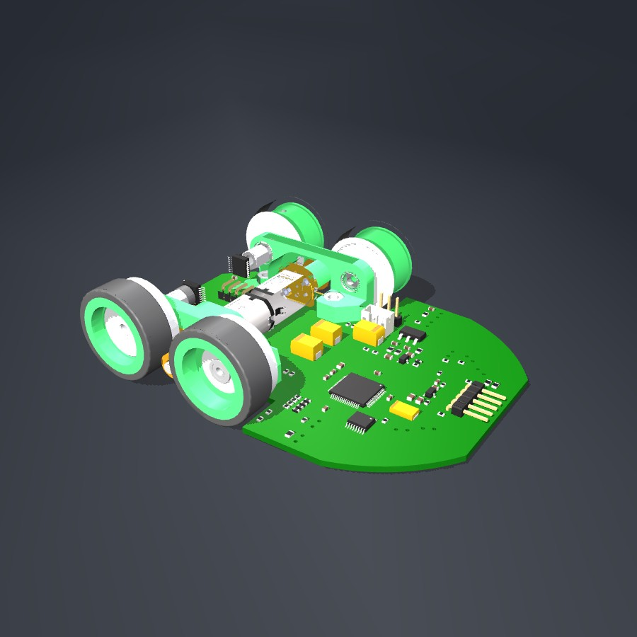
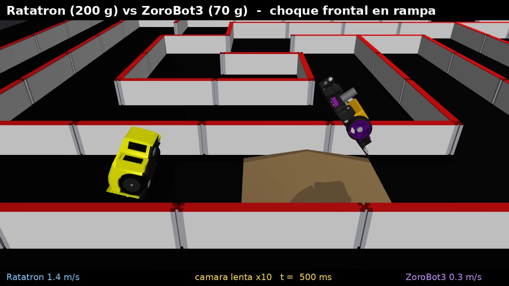

# ratasim


Micromouse robots in [MuJoCo](https://mujoco.org), each driven by **its own firmware**, compiled for the host and
unchanged, on a simulated chip (motors, encoders, IR sensors, gyro, flash, serial port), in mazes by the rules (16x16
cells of 180 mm).

## Robots

| [<br>**Ratatron**](docs/robots.md#ratatron) | [<br>**ZoroBot3**](docs/robots.md#zorobot3) | [<br>**Gamusino**](docs/robots.md#gamusino) |
|:-:|:-:|:-:|
| by [JavierIH](https://github.com/JavierIH) · [repo](https://github.com/JavierIH/ratatron) | by [OPRobots](https://oprobots.org) · [repo](https://github.com/OPRobots/ZoroBot3) | by [turmandreams](https://github.com/turmandreams) · [repo](https://github.com/turmandreams/gamusino) |
| STM32F103 · 4 Sharp IR · no gyro | STM32F405 · 4 IR · gyro · fan | ESP32 · 4 IR · gyro · fan |
| [<br>**Bulebule**](docs/robots.md#bulebule) | [<br>**NezumiBot**](docs/robots.md#nezumibot) | [<br>**Perenquén**](docs/robots.md#perenquén) |
| by [Bulebots](https://github.com/Bulebots) · [repo](https://github.com/Bulebots/bulebule) | by [OPRobots](https://oprobots.org) · [repo](https://github.com/OPRobots/NezumiBot) | by [supernudo](https://github.com/supernudo) · [repo](https://github.com/supernudo/perenquen) |
| STM32F103 · 4 IR · gyro · 4 wheels | STM32F401 · 4 Sharp IR · N20 motors | dsPIC33EP512MC806 · 4 IR · gyro · 4 wheels |

Each robot's firmware comes from its own repository, a submodule of `external/` pinned to a commit; its authors are
credited in [robots.md](docs/robots.md), with what was taken from where.

## Getting started

Linux (the firmware runs in a `ucontext` coroutine; on Windows, WSL2), Python 3.10+, a C compiler and `make`, and
`ffmpeg` for videos:

```sh
sudo apt install git python3-venv build-essential ffmpeg
git clone --recurse-submodules https://github.com/JavierIH/ratasim
cd ratasim
python3 -m venv .venv
. .venv/bin/activate
pip install -e .
```

### Ratatron in a maze

```sh
ratasim --maze oshwdem2026
```

A viewer opens with the maze and the robot, and the terminal becomes the robot's console, as over its Bluetooth link.
Its firmware is compiled on the first run and boots by itself. To make it move, type in the terminal:

```text
MODE 1          the search: from the start to the goal and back, mapping the maze
START
```

When it is back, `MODE 2 6` and `START` run the race (2.6, the fastest preset) on the map it saved. In the viewer,
Page Up is its SELECT button, Page Down its START and End puts it back at the start.

Without a screen (over SSH), headless, as fast as possible, with a video:

```sh
ratasim --headless --speed 0 --maze oshwdem2026 --cmd "MODE 1" --cmd START --until-idle --record search.mp4
```


The map, the telemetry and the console come from Ratatron's own tools, in the submodule:

```sh
pip install -e external/ratatron/software
ratatron connect --sim          # in another terminal while ratasim runs
ratatron monitor                # and another
```

More: [docs/simulator.md](docs/simulator.md) (what is simulated, what was matched to the robot, the studies:
`ratasim batch`, `curves`, `failures`, `mapdiff`, `ir-info`, `real-ir`, `demo`).

### ZoroBot3 in a maze

Its 3D model is its Onshape assembly, not part of its repository: in Onshape, right-click the "Full Assembly" tab,
Export, STEP as a single file, and save it as `ratasim/zorobot/cad/Full_Assembly.step`. Then:

```sh
pip install -e .[cad]           # gmsh, to make its meshes once
ratasim zorobot --maze oshwdem2026 --record zorobot.mp4
```

It boots its firmware, picks the run in its menu with its buttons and starts it with a hand in front of its right
front sensor, as on the real robot (`--run`: explore, then the speed run).


### Gamusino in a maze

```sh
ratasim gamusino --maze oshwdem2026 --record gamusino.mp4
```

Its sketch (`src/gamusino/gamusino.ino`) on its ESP32, under a simulated Arduino core: 1.5 m ahead at 1.6 m/s,
steering by its gyro and encoders, a stop, a 180 deg turn, a rest and back, over and over. It reads no wall sensor
yet: it is put down at the start of the maze's longest straight (in the OSHWDEM 2026 maze, ten cells along its south
wall) and switched on, as its maker starts it: green, its gyro measured, blue, it goes.


### NezumiBot in a maze

```sh
ratasim nezumibot --maze oshwdem2026 --hand left --record nezumibot.mp4
```

Its firmware as it ran at OSHWDEM 2023 (a wall follower), started as its makers start it: held in the air, a hand
at its right sensor (`--party`: at its left, and it swaps walls every 30 s after 45 s), a hand at the side of the
wall to follow, put down in the start cell, a hand in front; it starts 2 s later.


### Perenquén in a maze

```sh
ratasim perenquen --maze oshwdem2026 --side right --gain 30 --record perenquen.mp4
```

Its firmware's last commit on a simulated dsPIC: a command line over Bluetooth, and a wall follower. Started as its
maker drove it: in the start cell, `start right 30` typed in its terminal (it reads its diagonal sensors there, the
walls it will keep to), a hand in front of both front sensors, taken away: it goes. `--speed 1000` types
`traj_speed distance 1000` first (2 m/s; it boots at 0.78), `--console` leaves its command line in the terminal.


## Layout

```text
ratasim/            the simulator: the maze, the physics, Ratatron (its model, sensors, simulated chip in fw/)
ratasim/zorobot/    ZoroBot3: its model from its STEP, its simulated chip (fw/), its runner
ratasim/gamusino/   Gamusino: its model from the GLB in its repository, its ESP32 under an Arduino core (fw/), runner
ratasim/bulebule/   Bulebule: its board from its layout, its parts from KiCad's 3D library
ratasim/nezumibot/  NezumiBot: its assembled 3D model (assets/), its simulated chip (fw/), runner
ratasim/perenquen/  Perenquén: its meshes from its FreeCAD assembly (assets/, cad.py), its simulated dsPIC (fw/), runner
ratasim/opencm3/    the part of libopencm3 the simulated chips of ZoroBot3 and NezumiBot share
ratasim/start.py    starting a robot as its makers do (its config's sequence), with the hand of hand.py
ratasim/scenes/     several robots: drag race, crash, loop, pictures
ratasim/mazes/      competition mazes (micromouseonline text format)
external/           the robots' repositories (submodules)
docs/               robots.md (each robot, its authors), simulator.md (Ratatron in detail), plan.md
```

## Off the maze

Scenes with several robots, no firmware: each robot follows its own speed profile (Ratatron's race preset,
ZoroBot3's `SPEED_HAKI`) and keeps its lane.

```sh
ratasim drag-race race.mp4          # 3 m: start lights, lanes, a checkered finish
ratasim crash crash.mp4 --ramp      # head-on on the maze's longest straight, over a ramp
ratasim loop loop.mp4               # a loop-the-loop beside the maze
ratasim portraits                   # the pictures above
```

|  |  |  |
|:-:|:-:|:-:|

## Credits and licences

Every robot belongs to its authors (above); their repositories are submodules and nothing of them is copied here.
ZoroBot3, Bulebule and NezumiBot are GPLv3; Gamusino's repository carries no licence; Perenquén's design is CC BY-SA
4.0 (Javier Baliñas), its firmware and its library aversive4dspic (Droids Corporation, Microb Technology, Eirbot,
Eurobotics Engineering) GPLv2+; Gamusino's gyro library, STM32duino LSM6DSR (STMicroelectronics, BSD-3), is
downloaded at build time. The meshes made from ZoroBot3's, Gamusino's and Bulebule's CAD stay out of git; NezumiBot's and Perenquén's are in `ratasim/nezumibot/assets` and `ratasim/perenquen/assets`, under their licences.
