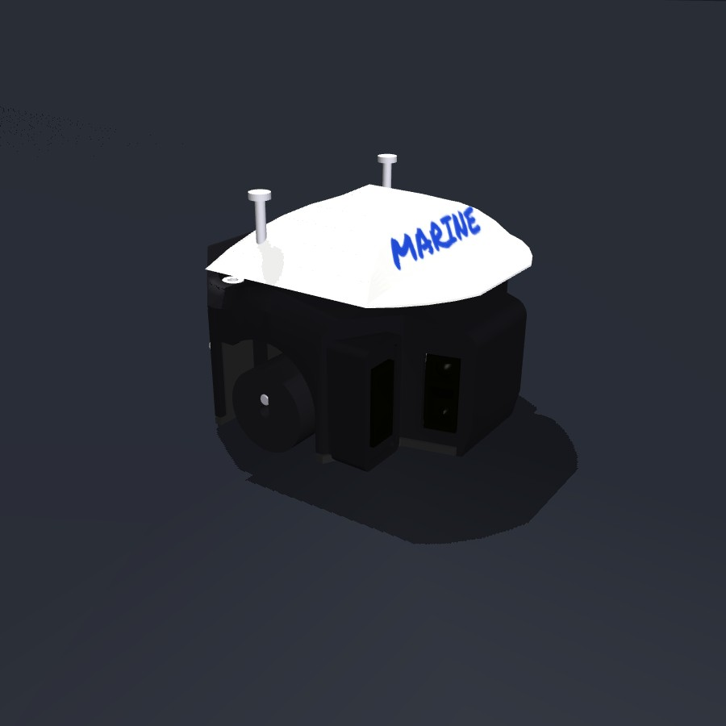
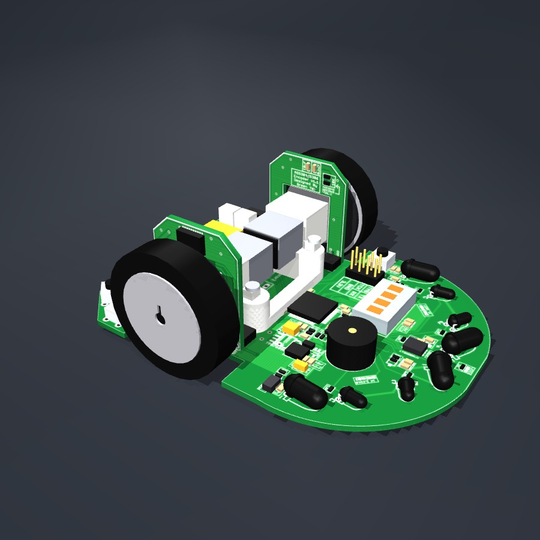
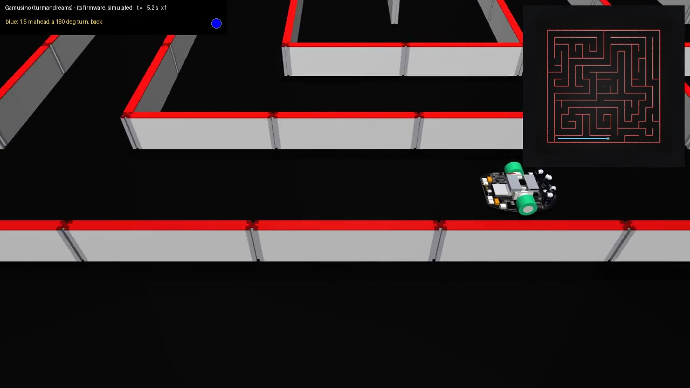
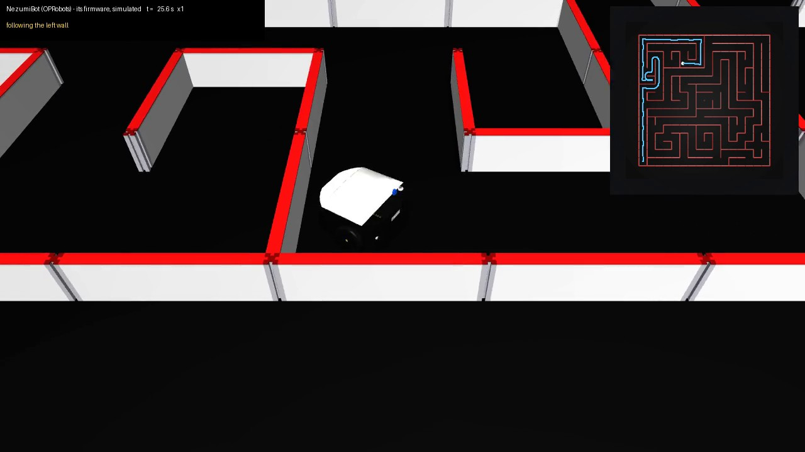
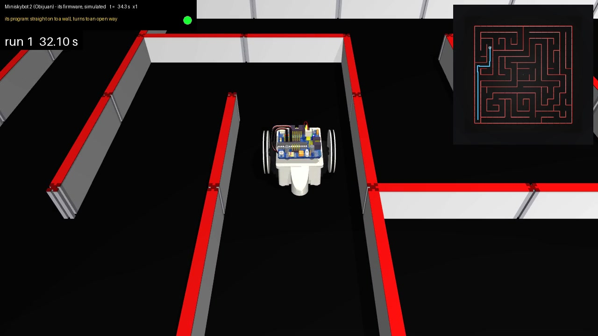
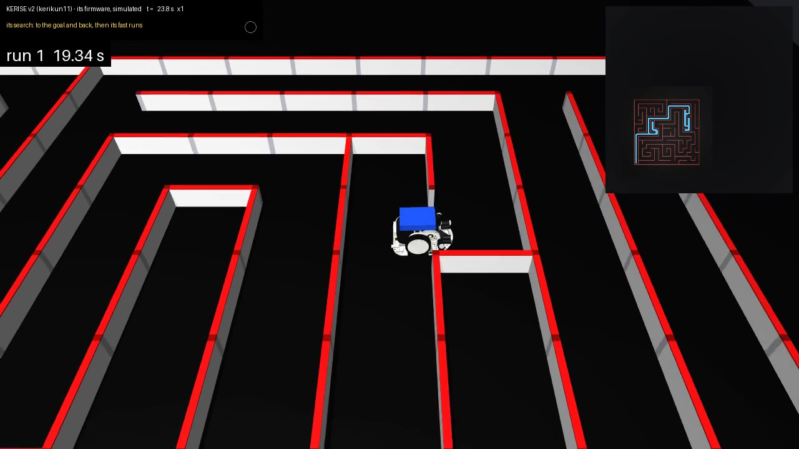

# ratasim

[](https://github.com/JavierIH/ratasim/actions/workflows/ci.yml)


Micromouse robots in [MuJoCo](https://mujoco.org), each driven by **its own firmware**, compiled for the host and
unchanged, on a simulated chip (motors, encoders, IR sensors, gyro, flash, serial port), in mazes by the rules (16x16
cells of 180 mm).

## Robots

<table>
<tr>
<td align="center" width="33%"><a href="docs/robots.md#ratatron"><br><b>Ratatron</b></a></td>
<td align="center" width="33%"><a href="docs/robots.md#zorobot3"><br><b>ZoroBot3</b></a></td>
<td align="center" width="33%"><a href="docs/robots.md#gamusino"><br><b>Gamusino</b></a></td>
</tr>
<tr>
<td align="center">by <a href="https://github.com/JavierIH">JavierIH</a> · <a href="https://github.com/JavierIH/ratatron">repo</a></td>
<td align="center">by <a href="https://oprobots.org">OPRobots</a> · <a href="https://github.com/OPRobots/ZoroBot3">repo</a></td>
<td align="center">by <a href="https://github.com/turmandreams">turmand<wbr>reams</a> · <a href="https://github.com/turmandreams/gamusino">repo</a></td>
</tr>
<tr>
<td align="center">STM32F103 · 4 Sharp IR · no gyro</td>
<td align="center">STM32F405 · 4 IR · gyro · fan</td>
<td align="center">ESP32 · 4 IR · gyro · fan</td>
</tr>
<tr>
<td align="center" width="33%"><a href="docs/robots.md#bulebule"><br><b>Bulebule</b></a></td>
<td align="center" width="33%"><a href="docs/robots.md#nezumibot"><br><b>NezumiBot</b></a></td>
<td align="center" width="33%"><a href="docs/robots.md#perenquén"><br><b>Perenquén</b></a></td>
</tr>
<tr>
<td align="center">by <a href="https://github.com/Bulebots">Bulebots</a> · <a href="https://github.com/Bulebots/bulebule">repo</a></td>
<td align="center">by <a href="https://oprobots.org">OPRobots</a> · <a href="https://github.com/OPRobots/NezumiBot">repo</a></td>
<td align="center">by <a href="https://github.com/supernudo">supernudo</a> · <a href="https://github.com/supernudo/perenquen">repo</a></td>
</tr>
<tr>
<td align="center">STM32F103 · 4 IR · gyro · 4 wheels</td>
<td align="center">STM32F401 · 4 Sharp IR · N20 motors</td>
<td align="center">dsPIC33<wbr>EP512<wbr>MC806 · 4 IR · gyro · 4 wheels</td>
</tr>
<tr>
<td align="center" width="33%"><a href="docs/robots.md#fujin"><br><b>Fujin</b></a></td>
<td align="center" width="33%"><a href="docs/robots.md#futura"><br><b>Futura</b></a></td>
<td align="center" width="33%"><a href="docs/robots.md#ukmarsbot"><br><b>UKMARSBOT</b></a></td>
</tr>
<tr>
<td align="center">by <a href="https://raiju.team">Team Raiju</a> · <a href="https://github.com/team-raiju/fujin">repo</a></td>
<td align="center">by <a href="https://micromouseusa.com">Green Ye</a> · <a href="https://micromouseusa.com/?page_id=1342">page</a></td>
<td align="center">by <a href="https://ukmars.org">UKMARS</a> · <a href="https://github.com/ukmars/ukmarsbot">repo</a></td>
</tr>
<tr>
<td align="center">STM32G474 · 4 IR · gyro · fan</td>
<td align="center">STM32F405 · 4 IR · gyro</td>
<td align="center">ATmega328P · 4 IR · N20 motors</td>
</tr>
<tr>
<td align="center" width="33%"><a href="docs/robots.md#miniskybot"><br><b>Miniskybot</b></a></td>
<td align="center" width="33%"><a href="docs/robots.md#kerise-v1"><br><b>KERISE v1</b></a></td>
<td width="33%"></td>
</tr>
<tr>
<td align="center">by <a href="https://github.com/Obijuan">Obijuan</a> · <a href="https://github.com/Obijuan/Miniskybot">repo</a></td>
<td align="center">by <a href="https://github.com/kerikun11">kerikun11</a> · <a href="https://github.com/kerikun11/micromouse-kerise-v1">repo</a></td>
<td></td>
</tr>
<tr>
<td align="center">ATmega328 · 1 ultrasonic · hacked servos</td>
<td align="center">STM32F405 · 4 IR · gyro</td>
<td></td>
</tr>
</table>

Each robot's firmware comes from its own repository, a submodule of `external/` pinned to a commit (Futura's, which
has none, from its page at build time, pinned by its hash); its authors are credited in [robots.md](docs/robots.md),
with what was taken from where.

## Getting started

Linux (the firmware runs in a `ucontext` coroutine; on Windows, WSL2), Python 3.10+, a C compiler and `make`, and
`ffmpeg` for videos:

```sh
sudo apt install git python3-venv build-essential ffmpeg
git clone https://github.com/JavierIH/ratasim
cd ratasim
git submodule update --init
python3 -m venv .venv
. .venv/bin/activate
pip install -e .
```

### Running Ratatron


```sh
ratasim --maze oshwdem2026
ratasim --maze oshwdem2026 --race 4
```

A viewer opens and the terminal becomes its console. The firmware is compiled on the first run; the robot searches to
the goal and back, then races on the saved map with `--race`. Page Up / Page Down are its SELECT and START buttons,
End puts it back at the start.

The other robots open MuJoCo's window at real time; `--headless`, `--record out.mp4` or no screen run without it
(`--speed 0`: as fast as possible). More: [docs/simulator.md](docs/simulator.md).

### Running ZoroBot3


```sh
pip install -e .[cad]           # gmsh, to make its meshes once
ratasim zorobot --maze oshwdem2026 --record zorobot.mp4
```

Export its Onshape "Full Assembly" as STEP to `ratasim/zorobot/cad/Full_Assembly.step` first. Started with a hand at
its right front sensor; `--run` explores, then speed runs.

### Running Gamusino



```sh
ratasim gamusino --maze oshwdem2026 --record gamusino.mp4
```

Its ESP32 sketch: 1.5 m ahead and back, over and over, on the maze's longest straight. It reads no walls yet.

### Running Bulebule


```sh
ratasim bulebule --maze oshwdem2026 --record bulebule.mp4
```

Its firmware on a simulated STM32F103 explores to the centre and back, saving the path in flash; `--run` races from
there (it does not reach the goal yet: [robots.md](docs/robots.md#bulebule)).

### Running NezumiBot



```sh
ratasim nezumibot --maze oshwdem2026 --hand left --record nezumibot.mp4
```

Its OSHWDEM 2023 wall follower, started with hands at its sensors. `--party` swaps walls every 30 s.

### Running Perenquén


```sh
ratasim perenquen --maze oshwdem2026 --side right --gain 30 --record perenquen.mp4
```

A wall follower on a simulated dsPIC, started as its maker does (`start right 30` in its terminal, then a hand).
`--speed 1000` sets 2 m/s.

### Running Fujin


```sh
pip install -e .[cad]           # gmsh, to make its meshes from its STEP once
ratasim fujin --maze oshwdem2026 --record fujin.mp4
```

Its RCX 2026 firmware (C++23: g++ 13 or clang++ 15) searches to the goal and back. `--mode slow` (0.3 m/s) finishes;
medium and fast do not yet.

### Running Futura


```sh
ratasim futura --maze oshwdem2026 --echo --record futura.mp4
```

UCLA IEEE's kit mouse with its students' controller sample ([robots.md](docs/robots.md#futura)): it drives cell to
cell and pivots at walls, searching nothing. `--echo` prints its serial port.

### Running UKMARSBOT


```sh
ratasim ukmarsbot --maze oshwdem2026 --record ukmarsbot.mp4
```

mazerunner-core on a simulated ATmega328P: flood fill to the goal and back. `--function 3` runs its left wall
follower instead.

### Running Miniskybot



```sh
ratasim miniskybot --maze oshwdem2026 --echo --record miniskybot.mp4
```

Obijuan's printable robot (servos, ultrasonic ranger, ATmega328): straight to a wall, then turns by time to an open
way. `--echo` prints what it says.

### Running KERISE v1



```sh
ratasim kerise --maze oshwdem2026 --record kerise.mp4
```

kerikun11's 2016 classic micromouse with its All Japan contest firmware on a simulated STM32F405 (mbed OS 5.1).
It searches to the goal (84.3 s) and back (158 s), then makes its fast runs (41.4 s, 34.6 s). `--echo` prints its
console.

## Tests and CI

`tests/robots.py` puts each robot in the OSHWDEM 2026 maze and checks what it prints. CI runs the short check, one job
per robot:

```sh
python tests/robots.py [robot ...]           # short: builds, starts, runs and leaves the start cell
python tests/robots.py --full [robot ...]    # full: each robot's whole run (slower, for local use)
```

## Scenes

Several robots at once, picked by name (`--robots fujin,zorobot,ukmarsbot`, or `all`). The race in the maze replays
each robot's own traced run together in one maze. Minisumo puts them all on a dohyo until one is left, with a simple
control of its own. Drag race, crash and loop use each robot's speed profile, without its firmware.

```sh
ratasim maze-race maze-race.mp4     # Ratatron, ZoroBot3, Bulebule, Fujin, UKMARSBOT: their searches, x4
ratasim drag-race race.mp4          # 3 m, all ten: start lights, lanes, a checkered finish
ratasim minisumo sumo.mp4           # all ten on one dohyo, the last one left wins
ratasim minisumo --still podium.jpg --podium    # a picture of the podium after the bout
ratasim crash crash.mp4 --ramp      # Ratatron and ZoroBot3 head-on on the maze's longest straight, over a ramp
ratasim loop loop.mp4               # Ratatron and ZoroBot3 through a loop-the-loop beside the maze
ratasim portraits                   # the pictures above
```

|  |  |
|:-:|:-:|
|  |  |
|  |  |

## Credits and licences

ratasim is free software under the GNU General Public License v3 or later (`LICENSE`, Copyright (C) 2026 JavierIH); each
robot keeps its authors' licence, as below, and what is a submodule or is downloaded at build time is not relicensed.

Every robot belongs to its authors (above); their repositories are submodules and nothing of them is copied here.
ZoroBot3, Bulebule and NezumiBot are GPLv3; Gamusino's, Fujin's and KERISE v1's repositories carry no licence (KERISE's author allows ratasim to use it); Perenquén's design is CC BY-SA
4.0 (Javier Baliñas), its firmware and its library aversive4dspic (Droids Corporation, Microb Technology, Eirbot,
Eurobotics Engineering) GPLv2+; Gamusino's gyro library, STM32duino LSM6DSR (STMicroelectronics, BSD-3), is
downloaded at build time. Futura's page (Green Ye, micromouseusa.com) gives no licence: its firmware template, its
controller sample, its board's Gerber files and its printed parts are downloaded at build time, pinned by their
SHA-256, and stay out of git; ST's library is not used
(`ratasim/futura/fw` simulates the part of its API the template calls). Fujin's team's photos of its board
(raiju.team), its art's only source, are downloaded at build time, pinned by their SHA-256, and stay out of git.
Miniskybot's repository is GPL or CC BY-SA (its README; its page CC BY-SA 3.0 ES). The meshes made from ZoroBot3's, Gamusino's, Bulebule's, Fujin's, Miniskybot's and KERISE v1's CAD stay out of git; NezumiBot's and Perenquén's are in `ratasim/nezumibot/assets` and `ratasim/perenquen/assets`, under their licences.
