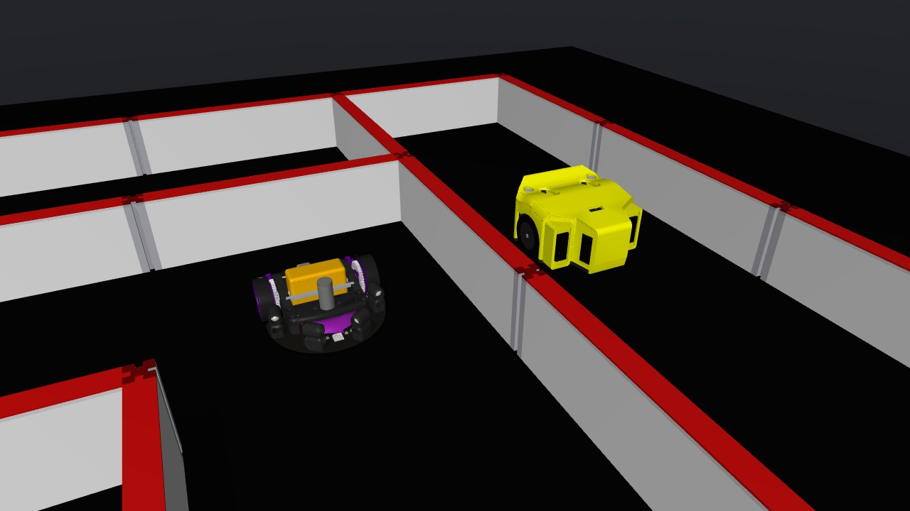
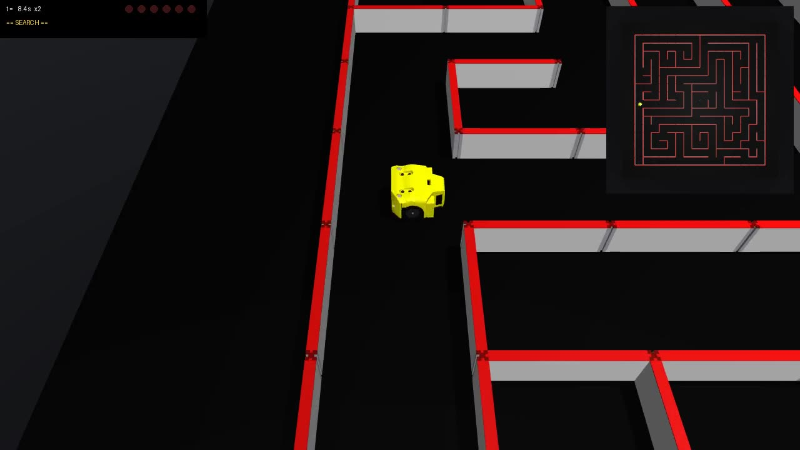
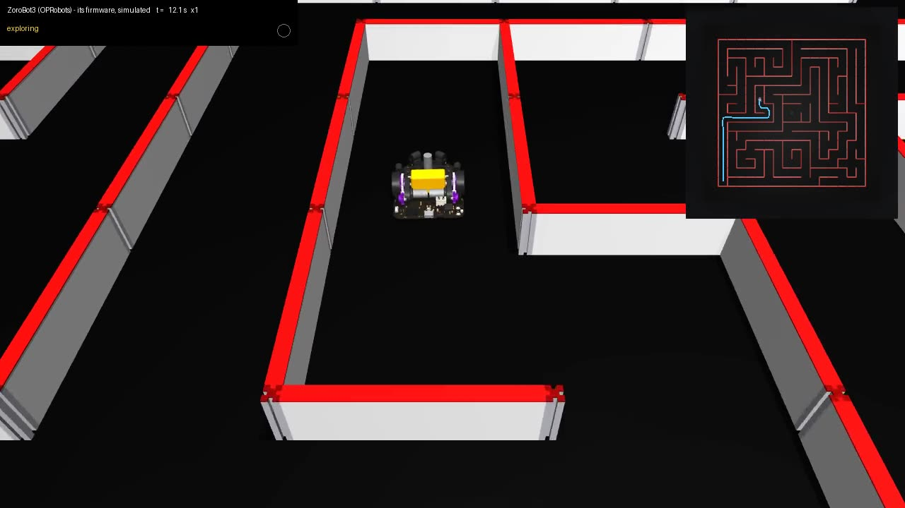
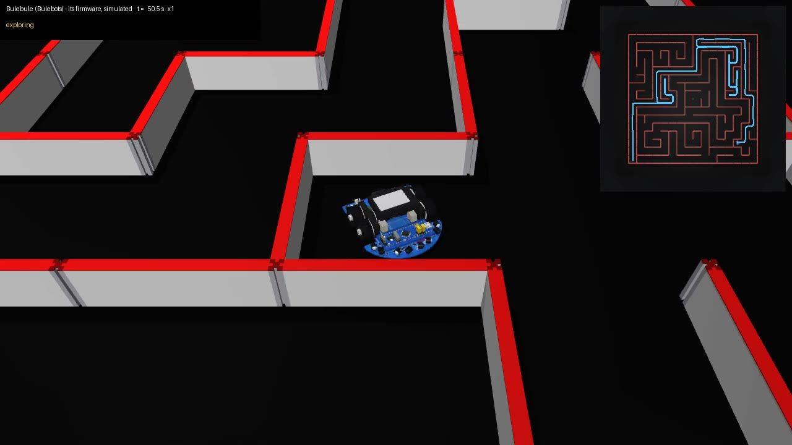
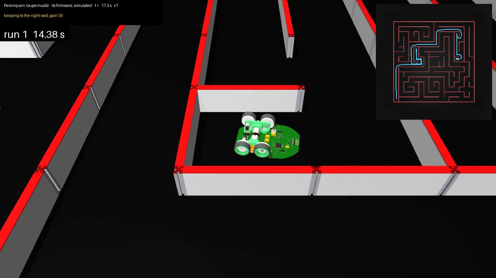
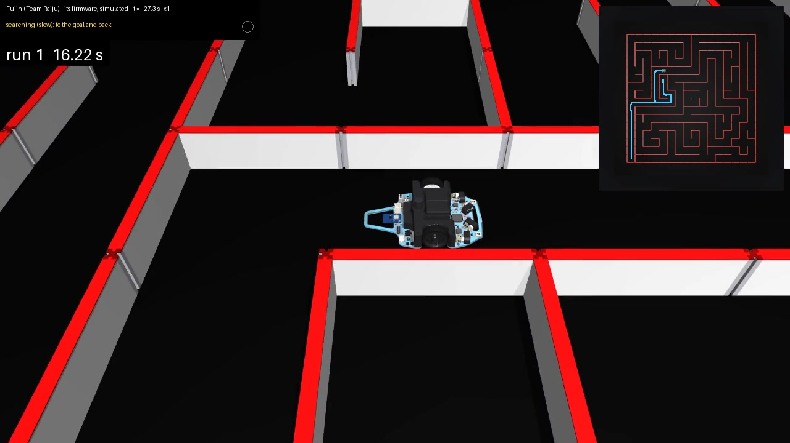
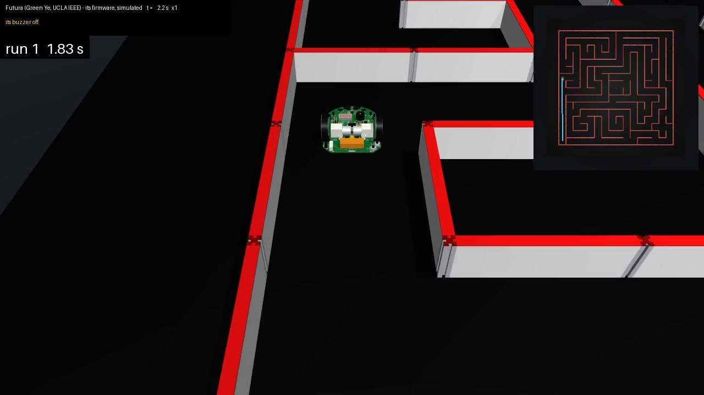
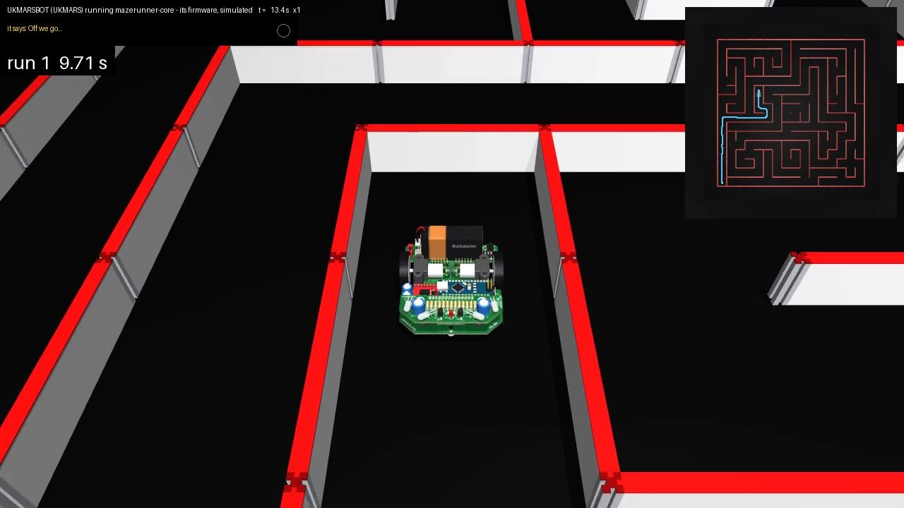
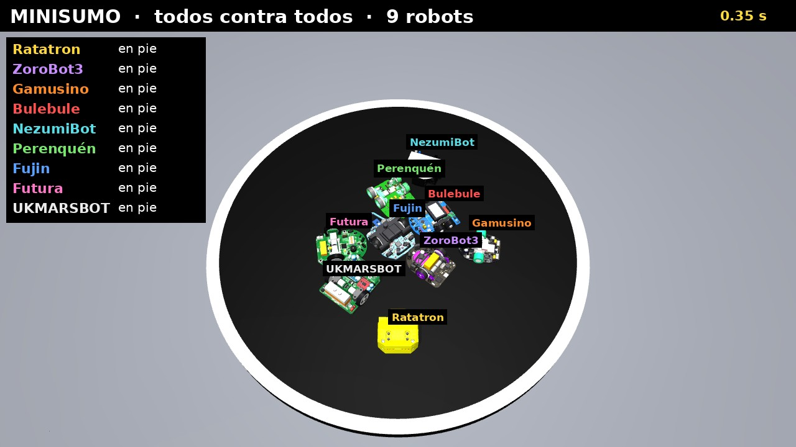
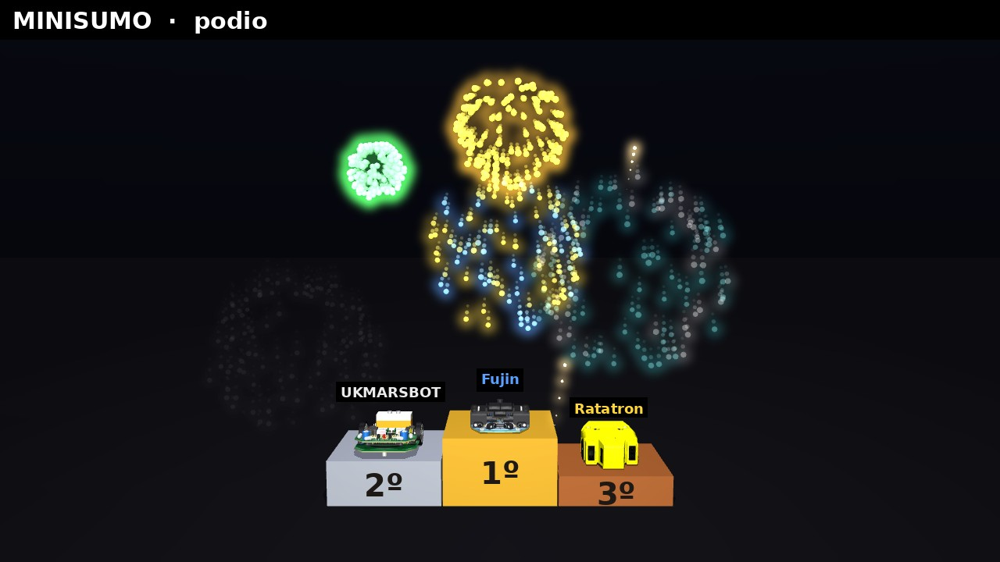

# ratasim

[](https://github.com/JavierIH/ratasim/actions/workflows/ci.yml)



Micromouse robots in [MuJoCo](https://mujoco.org), each driven by **its own firmware**, compiled for the host and
unchanged, on a simulated chip (motors, encoders, IR sensors, gyro, flash, serial port), in mazes by the rules (16x16
cells of 180 mm).

## Robots

<table>
<tr>
<td align="center" width="33%"><a href="docs/robots.md#ratatron"><br><b>Ratatron</b></a></td>
<td align="center" width="33%"><a href="docs/robots.md#zorobot3"><br><b>ZoroBot3</b></a></td>
<td align="center" width="33%"><a href="docs/robots.md#gamusino"><br><b>Gamusino</b></a></td>
</tr>
<tr>
<td align="center">by <a href="https://github.com/JavierIH">JavierIH</a> · <a href="https://github.com/JavierIH/ratatron">repo</a></td>
<td align="center">by <a href="https://oprobots.org">OPRobots</a> · <a href="https://github.com/OPRobots/ZoroBot3">repo</a></td>
<td align="center">by <a href="https://github.com/turmandreams">turmand<wbr>reams</a> · <a href="https://github.com/turmandreams/gamusino">repo</a></td>
</tr>
<tr>
<td align="center">STM32F103 · 4 Sharp IR · no gyro</td>
<td align="center">STM32F405 · 4 IR · gyro · fan</td>
<td align="center">ESP32 · 4 IR · gyro · fan</td>
</tr>
<tr>
<td align="center" width="33%"><a href="docs/robots.md#bulebule"><br><b>Bulebule</b></a></td>
<td align="center" width="33%"><a href="docs/robots.md#nezumibot"><br><b>NezumiBot</b></a></td>
<td align="center" width="33%"><a href="docs/robots.md#perenquén"><br><b>Perenquén</b></a></td>
</tr>
<tr>
<td align="center">by <a href="https://github.com/Bulebots">Bulebots</a> · <a href="https://github.com/Bulebots/bulebule">repo</a></td>
<td align="center">by <a href="https://oprobots.org">OPRobots</a> · <a href="https://github.com/OPRobots/NezumiBot">repo</a></td>
<td align="center">by <a href="https://github.com/supernudo">supernudo</a> · <a href="https://github.com/supernudo/perenquen">repo</a></td>
</tr>
<tr>
<td align="center">STM32F103 · 4 IR · gyro · 4 wheels</td>
<td align="center">STM32F401 · 4 Sharp IR · N20 motors</td>
<td align="center">dsPIC33<wbr>EP512<wbr>MC806 · 4 IR · gyro · 4 wheels</td>
</tr>
<tr>
<td align="center" width="33%"><a href="docs/robots.md#fujin"><br><b>Fujin</b></a></td>
<td align="center" width="33%"><a href="docs/robots.md#futura"><br><b>Futura</b></a></td>
<td align="center" width="33%"><a href="docs/robots.md#ukmarsbot"><br><b>UKMARSBOT</b></a></td>
</tr>
<tr>
<td align="center">by <a href="https://raiju.team">Team Raiju</a> · <a href="https://github.com/team-raiju/fujin">repo</a></td>
<td align="center">by <a href="https://micromouseusa.com">Green Ye</a> · <a href="https://micromouseusa.com/?page_id=1342">page</a></td>
<td align="center">by <a href="https://ukmars.org">UKMARS</a> · <a href="https://github.com/ukmars/ukmarsbot">repo</a> · <a href="https://github.com/ukmars/mazerunner-core">firmware</a></td>
</tr>
<tr>
<td align="center">STM32G474 · 4 IR · gyro · fan</td>
<td align="center">STM32F405 · 4 IR · gyro · its page's controller sample</td>
<td align="center">ATmega328P · 4 IR · N20 motors</td>
</tr>
</table>

Each robot's firmware comes from its own repository, a submodule of `external/` pinned to a commit (Futura's, which
has none, from its page at build time, pinned by its hash); its authors are credited in [robots.md](docs/robots.md),
with what was taken from where.

## Getting started

Linux (the firmware runs in a `ucontext` coroutine; on Windows, WSL2), Python 3.10+, a C compiler and `make`, and
`ffmpeg` for videos:

```sh
sudo apt install git python3-venv build-essential ffmpeg
git clone --recurse-submodules https://github.com/JavierIH/ratasim
cd ratasim
python3 -m venv .venv
. .venv/bin/activate
pip install -e .
```

### Ratatron in a maze

```sh
ratasim --maze oshwdem2026
```

A viewer opens with the maze and the robot, and the terminal becomes the robot's console, as over its Bluetooth link.
Its firmware is compiled on the first run and boots by itself, and it is started as at a competition: switched on in
the start cell, SELECT picks mode 1 and START launches the search after a 5 s countdown, from the start to the goal
and back, mapping the maze. When it is back, the race on the map it saved:

```sh
ratasim --maze oshwdem2026 --race 4      # race 2.4 of its race menu (SELECT twice, START, SELECT 3 times, START)
```

The console stays open meanwhile: `MODE 2 6` and `START` (or `:select`, `:start`, its buttons) run the fastest race;
`--console`: not started, only the console. In the viewer, Page Up is its SELECT button, Page Down its START and
End puts it back at the start.

The other robots (`ratasim zorobot|gamusino|bulebule|nezumibot|perenquen|fujin|futura|ukmarsbot`) also open MuJoCo's window, at real time
(`--record-speed 2` for twice that); with `--headless`, or `--record out.mp4` (a video instead of the window), or no
screen, they run without it.

Without a screen (over SSH), headless, as fast as possible, with a video:

```sh
ratasim --headless --speed 0 --maze oshwdem2026 --record search.mp4
```



The map, the telemetry and the console come from Ratatron's own tools, in the submodule:

```sh
pip install -e external/ratatron/software
ratatron connect --sim          # in another terminal while ratasim runs
ratatron monitor                # and another
```

More: [docs/simulator.md](docs/simulator.md) (what is simulated, what was matched to the robot, the studies:
`ratasim batch`, `curves`, `failures`, `mapdiff`, `ir-info`, `real-ir`, `demo`).

### ZoroBot3 in a maze

Its 3D model is its Onshape assembly, not part of its repository: in Onshape, right-click the "Full Assembly" tab,
Export, STEP as a single file, and save it as `ratasim/zorobot/cad/Full_Assembly.step`. Then:

```sh
pip install -e .[cad]           # gmsh, to make its meshes once
ratasim zorobot --maze oshwdem2026 --record zorobot.mp4
```

It boots its firmware, picks the run in its menu with its buttons and starts it with a hand in front of its right
front sensor, as on the real robot (`--run`: explore, then the speed run).



### Gamusino in a maze

```sh
ratasim gamusino --maze oshwdem2026 --record gamusino.mp4
```

Its sketch (`src/gamusino/gamusino.ino`) on its ESP32, under a simulated Arduino core: 1.5 m ahead at 1.6 m/s,
steering by its gyro and encoders, a stop, a 180 deg turn, a rest and back, over and over. It reads no wall sensor
yet: it is put down at the start of the maze's longest straight (in the OSHWDEM 2026 maze, ten cells along its south
wall) and switched on, as its maker starts it: green, its gyro measured, blue, it goes.


### Bulebule in a maze

```sh
ratasim bulebule --maze oshwdem2026 --record bulebule.mp4
```

Its firmware (libopencm3 on its STM32F103, with its library mmlib) on a simulated chip, started as its makers start
it, with its button and a hand: a press wakes it, a long one picks the classic goal (the maze's centre), short presses
and a long one its force (0.25 N, its boot's); it blinks, waits with its LEDs on for a hand in front, and 2 s after the
hand goes it calibrates and goes. It explores to the centre and on, through the cells that could make a shorter path,
back to its start, and saves the path in its flash (`ratasim/bulebule/build/flash.bin`); `--run` races it from there,
to the goal and back (it does not get there yet: [robots.md](docs/robots.md#bulebule)).



### NezumiBot in a maze

```sh
ratasim nezumibot --maze oshwdem2026 --hand left --record nezumibot.mp4
```

Its firmware as it ran at OSHWDEM 2023 (a wall follower), started as its makers start it: held in the air, a hand
at its right sensor (`--party`: at its left, and it swaps walls every 30 s after 45 s), a hand at the side of the
wall to follow, put down in the start cell, a hand in front; it starts 2 s later.


### Perenquén in a maze

```sh
ratasim perenquen --maze oshwdem2026 --side right --gain 30 --record perenquen.mp4
```

Its firmware's last commit on a simulated dsPIC: a command line over Bluetooth, and a wall follower. Started as its
maker drove it: in the start cell, `start right 30` typed in its terminal (it reads its diagonal sensors there, the
walls it will keep to), a hand in front of both front sensors, taken away: it goes. `--speed 1000` types
`traj_speed distance 1000` first (2 m/s; it boots at 0.78), `--console` leaves its command line in the terminal.



### Fujin in a maze

```sh
pip install -e .[cad]           # gmsh, to make its meshes from its STEP once
ratasim fujin --maze oshwdem2026 --record fujin.mp4
```

Its firmware (its RCX 2026 tag), C++23, on a board support package of ours behind its own BSP interface: its search,
to the goal and back, its map in its EEPROM. Started as its makers start it: button 2 (search), its speeds picked
with its buttons (`--mode slow`: 0.3 m/s, no fan; medium and fast do not finish yet), its exploration, and a hand in
front of its front sensors; two seconds' beep and it goes. It needs g++ 13 or clang++ 15 or later.



### Futura in a maze

```sh
ratasim futura --maze oshwdem2026 --echo --record futura.mp4
```

The kit mouse of UCLA IEEE's Project Futura, with the firmware template its students start from and the controller
sample its page gives them (both downloaded from its page on the first run), around a main routine of ratasim's
([robots.md](docs/robots.md#futura)). The sample's speed profile and PD controller every millisecond take it from
cell to cell at 0.5 m/s, kept in the middle by its side IR pairs; at a wall it stops in the cell's middle and pivots
on its gyro, left, then right, then back, until the way is open. It searches nothing: in the OSHWDEM 2026 maze it
goes up the west column and round to the north rows, and from 33 s on runs to and fro between two dead ends. Its
serial port (`--echo`) prints each cell, wall and pivot.



### UKMARSBOT in a maze

```sh
ratasim ukmarsbot --maze oshwdem2026 --record ukmarsbot.mp4
```

mazerunner-core, Peter Harrison's firmware for it, as his ORION, on its Arduino Nano's ATmega328P (its registers,
timers, ADC and interrupts simulated): its search, flood fill from the start to the goal and back, mapping the maze.
Started as at a contest: backed up to the start cell's wall, switched on with its button held (its map cleared), its
function switches at 2 and its button pressed, a hand in front of its left front sensor (`--function 3`: its left
wall follower to the goal; `--console`: its serial command line afterwards).



## The stopwatch

Every runner times the robot's runs as at a competition: the stopwatch starts when the robot's centre leaves the
start cell, from zero every time it does, and stops when it enters the goal (the centre 2x2 cells; Ratatron's
`--practice` build: its cell 3,2). Putting the robot somewhere by hand (Ratatron's `:place`, `:reset`) ends the run.
MuJoCo's window shows the time in its top right corner, and videos under their title, green once at the goal. The
runners print it, and `tests/robots.py` reports the times: its short check fails a robot whose run never starts
(it does not leave the start cell), its full check Ratatron, ZoroBot3, Fujin and UKMARSBOT if they reach the goal
without one:

```text
[   5.33] stopwatch: run 1 started (left the start cell)
[  38.12] stopwatch: run 1 at the goal (8, 8) in 32.785 s
```

## Tests and CI

`tests/robots.py` puts each robot in the OSHWDEM 2026 maze, started as its makers start it, and checks what it
prints (its docstring says what passes). The CI runs it one job per robot, in its short check:

```sh
python tests/robots.py [robot ...]           # short: it builds, starts, runs and leaves the start cell
python tests/robots.py --full [robot ...]    # full: its whole run (search to the goal and back, races, ...)
```

The short check (the default) asks each robot for the basics: its firmware builds, its start sequence runs, for a
few simulated seconds its firmware neither halts nor resets, the runner ends without an error, and the robot leaves
the start cell (the stopwatch starts a run); wall touches fail the robots that run clean (Ratatron, NezumiBot,
Futura). The full check is each robot's whole run, as `docs/robots.md` tells it: Ratatron's search and race 2.4,
the explorations of ZoroBot3, Bulebule, Fujin and UKMARSBOT to the goal (and back for most), NezumiBot's and
Perenquén's wall following, Gamusino's 1.5 m and back, Futura's cells and pivots to the maze's north rows. It takes
longer, and some of those runs are sensitive to numerical perturbations (UKMARSBOT's way back from the goal touches
a wall with 3 seeds in 10), so it is for local use.

## Layout

```text
ratasim/            the simulator: the maze, the physics, Ratatron (its model, sensors, simulated chip in fw/)
ratasim/zorobot/    ZoroBot3: its model from its STEP, its simulated chip (fw/), its runner
ratasim/gamusino/   Gamusino: its model from the GLB in its repository, its ESP32 under an Arduino core (fw/), runner
ratasim/bulebule/   Bulebule: its board from its layout, its parts from KiCad's library, its simulated chip (fw/), runner
ratasim/nezumibot/  NezumiBot: its assembled 3D model (assets/), its simulated chip (fw/), runner
ratasim/perenquen/  Perenquén: its meshes from its FreeCAD assembly (assets/, cad.py), its simulated dsPIC (fw/), runner
ratasim/fujin/      Fujin: its model from its STEP and its board's photos (cad.py, board.py), its firmware on our BSP and simulated STM32G474 (fw/), runner
ratasim/futura/     Futura: its files downloaded at build time, its model, its simulated STM32F405 and ST library (fw/)
ratasim/ukmarsbot/  UKMARSBOT: its model from its KiCad boards and Gerbers (cad.py, pcb.py), its Nano's ATmega328P (fw/)
ratasim/opencm3/    the part of libopencm3 the simulated chips of ZoroBot3 and NezumiBot share
ratasim/start.py    starting a robot as its makers do (its config's sequence), with the hand of hand.py
ratasim/stopwatch.py the runs' times, from the start cell to the goal (every robot)
ratasim/scenes/     several robots: drag race, a race in the maze, minisumo, crash, loop, pictures
ratasim/trace.py    a run traced (--trace) for the race in the maze
ratasim/mazes/      competition mazes (micromouseonline text format)
external/           the robots' repositories (submodules)
tests/robots.py    every robot in the maze, checked by what it prints (short, the CI: one job per robot; --full)
docs/               robots.md (each robot, its authors), simulator.md (Ratatron in detail)
```

## Scenes

Several robots at once, picked by their commands' names (`--robots fujin,zorobot,ukmarsbot`, or `all`).

The race in the maze puts the robots' own runs together: each robot runs alone with its firmware, started as its
makers start it (as `tests/robots.py` does), its run traced (`--trace`, cached in `build/scenes/traces`); then the
runs are replayed in one maze, each from the moment it leaves the start cell, the robots going through each other
(they never met). The stopwatch's times to the goal, a camera on the leader, each robot's trail.

The other scenes have no firmware: each robot follows the speed profile its firmware gives its straights
(Ratatron's race preset, ZoroBot3's `SPEED_HAKI`, Fujin's "super" forward with its fan, UKMARSBOT's fast run,
Bulebule's speed limit at its force, Futura's, Perenquén's, Gamusino's; NezumiBot's 40 % PWM) and keeps its lane;
Ratatron's and ZoroBot3's motor models, the others a speed servo as quick as Ratatron's.

Minisumo puts them all at once on a minisumo dohyo (77 cm across with its 2.5 cm white border, 2.5 cm high),
evenly spaced round its edge facing its centre, in one simulation: they push each other, each with its own mass,
tyres and power. Their firmwares know no sumo: the scene drives them all with the same simple control of its own,
full speed (each its drag race profile's) to the centre, then at the nearest robot left, back to the centre over the
white border, backing off when stuck; ZoroBot3's and Fujin's fans off (minisumo's rules forbid suction). A robot is
out when its centre leaves the dohyo or it lies toppled; the last one left wins (`ratasim minisumo --help`). It
prints the order they went out in, the winner and the podium, the same every run. After the bout the video fades to
black and goes on to the podium: its first three (two with two robots) on their blocks, the camera on each from the
3rd to the 1st, then the whole podium under fireworks (the same every run too).

```sh
ratasim maze-race maze-race.mp4     # Ratatron, ZoroBot3, Bulebule, Fujin, UKMARSBOT: their searches, x4
ratasim drag-race race.mp4          # 3 m, all nine: start lights, lanes, a checkered finish
ratasim drag-race race.mp4 --robots fujin,zorobot
ratasim minisumo sumo.mp4           # all nine on one dohyo, the last one left wins (all nine: Fujin, at 12.0 s)
ratasim minisumo sumo.mp4 --robots ratatron,zorobot,fujin
ratasim minisumo --still podium.jpg --podium    # a picture of the podium after the bout, with its fireworks
ratasim crash crash.mp4 --ramp      # Ratatron and ZoroBot3 head-on on the maze's longest straight, over a ramp
ratasim loop loop.mp4               # Ratatron and ZoroBot3 through a loop-the-loop beside the maze
ratasim portraits                   # the pictures above
```

|  |  |
|:-:|:-:|
|  |  |
|  |  |

## Credits and licences

Every robot belongs to its authors (above); their repositories are submodules and nothing of them is copied here.
ZoroBot3, Bulebule and NezumiBot are GPLv3; Gamusino's and Fujin's repositories carry no licence; Perenquén's design is CC BY-SA
4.0 (Javier Baliñas), its firmware and its library aversive4dspic (Droids Corporation, Microb Technology, Eirbot,
Eurobotics Engineering) GPLv2+; Gamusino's gyro library, STM32duino LSM6DSR (STMicroelectronics, BSD-3), is
downloaded at build time. Futura's page (Green Ye, micromouseusa.com) gives no licence: its firmware template, its
controller sample, its board's Gerber files and its printed parts are downloaded at build time, pinned by their
SHA-256, and stay out of git; ST's library is not used
(`ratasim/futura/fw` simulates the part of its API the template calls). Fujin's team's photos of its board
(raiju.team), its art's only source, are downloaded at build time, pinned by their SHA-256, and stay out of git.
The meshes made from ZoroBot3's, Gamusino's, Bulebule's and Fujin's CAD stay out of git; NezumiBot's and Perenquén's are in `ratasim/nezumibot/assets` and `ratasim/perenquen/assets`, under their licences.
