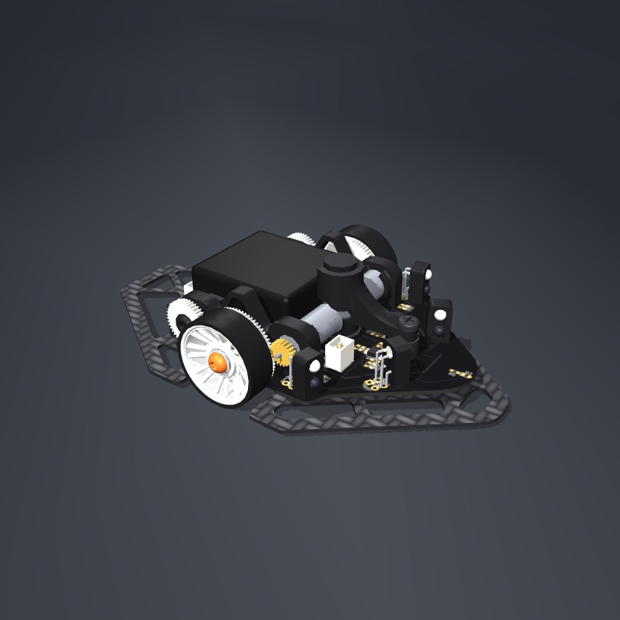
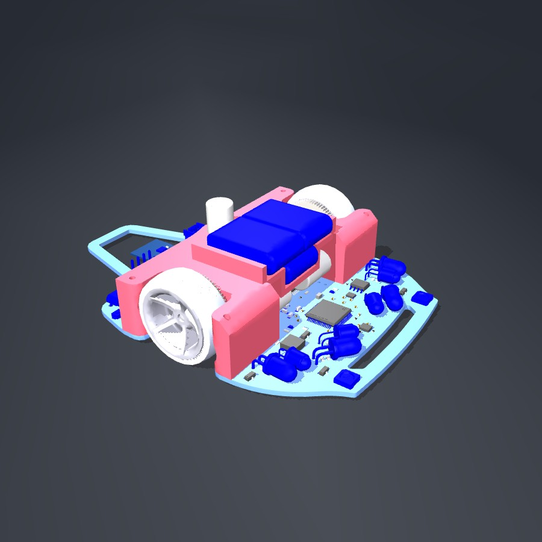
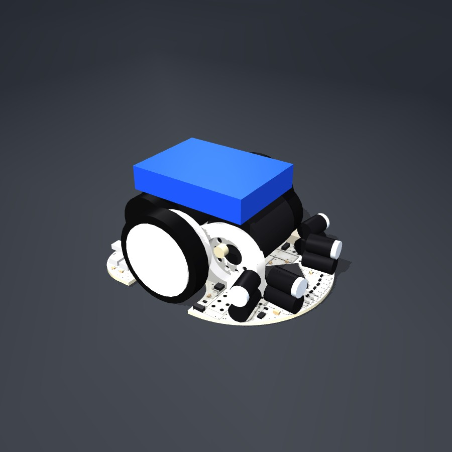
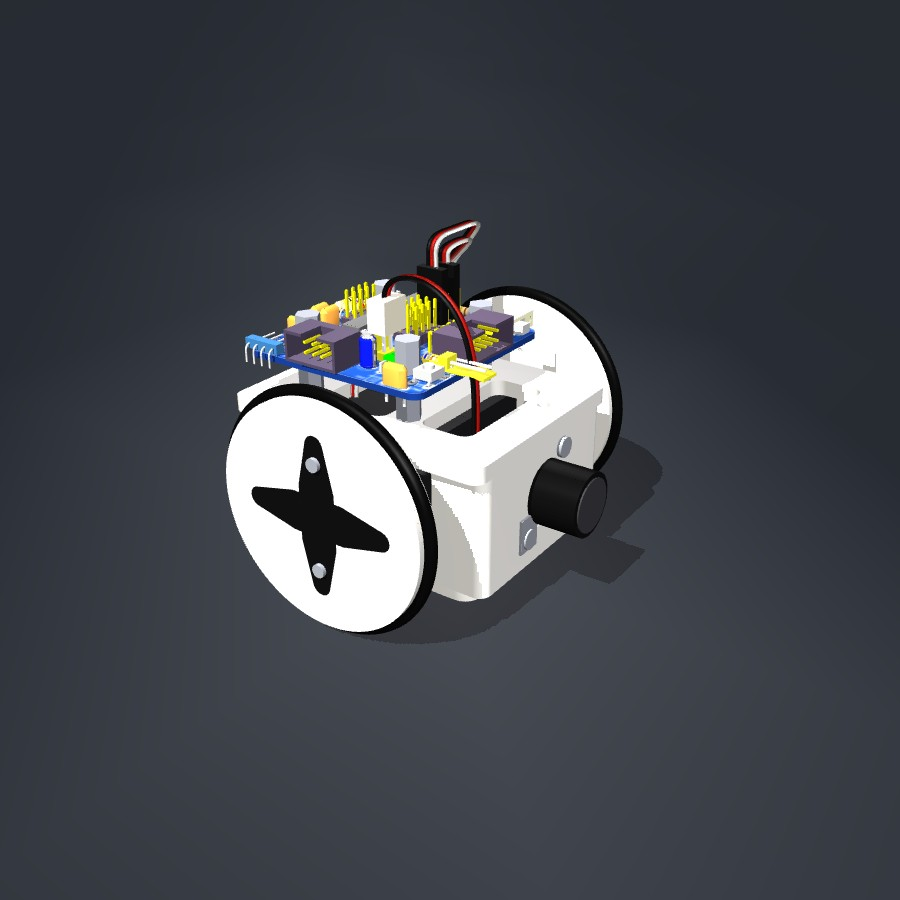
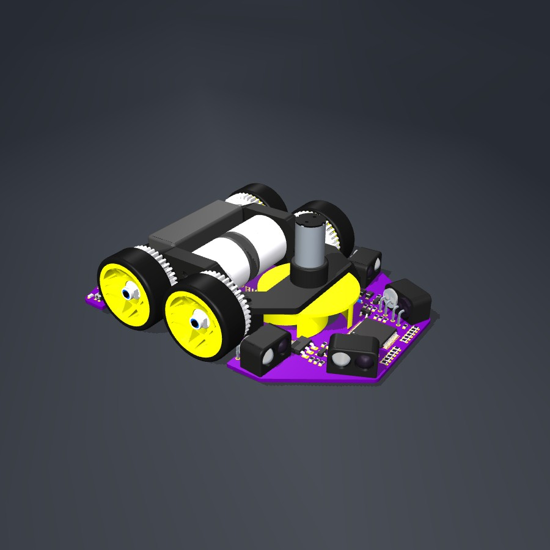

# Robots

Every robot is a package of `ratasim/` with the same parts: its **model** (meshes from its CAD, collisions from simple
shapes), its **physics** (mass, motors, tires; what was measured apart from what is assumed), its **sensors** (IR rays
through its firmware's own calibration, encoders, gyro), its **firmware**, compiled for the host from its
repository (a submodule of `external/`) on a simulated chip, and its **start**: what its makers do to start it
(buttons, a hand in front of a sensor, held in the air, commands typed over its serial link), a sequence in its config (`start()`) that
`ratasim/start.py` plays with the hand of `ratasim/hand.py`, which every sensor sees. The pictures:
`ratasim portraits`.

`tests/robots.py` checks every robot in the maze, started as below. Its short check (the CI's, the default) only
asks that its firmware builds, its start sequence runs, its firmware does not stop in a few simulated seconds and
the robot leaves the start cell (the stopwatch starts a run). Its full check (`--full`) is each robot's whole run
as its **Run** line below tells it (to the goal and back, races, wall following), for local use.

## Ratatron

By [JavierIH](https://github.com/JavierIH) · [JavierIH/ratatron](https://github.com/JavierIH/ratatron)

- **Firmware:** `external/ratatron/firmware/src`, unchanged, on a fake STM32 HAL (`ratasim/fw/`): its application
  files and `gpio.c`/`infrared.c` as they are, the motors, encoders, UART, flash and clock simulated.
- **Model:** its FreeCAD assembly, exported to `ratasim/assets` (`ratasim/export_cad.py`).
- **Start:** switched on in the start cell, SELECT picks mode 1, START launches the search after a 5 s countdown
  (`--race K`: race K of its race menu, on the map saved).
- **Run:** `ratasim ratatron --maze oshwdem2026` (its console stays open: `MODE 2 6`, `START`, ...). Details, calibration and
  the studies: [simulator.md](simulator.md).

## ZoroBot3

By [OPRobots](https://oprobots.org) · [OPRobots/ZoroBot3](https://github.com/OPRobots/ZoroBot3) (GPLv3)

- **Firmware:** `external/ZoroBot3`, unchanged, on a fake libopencm3 chip (`ratasim/zorobot/fw/`): its `main()` in a
  coroutine, its SysTick at 16 kHz (its IR emitter/ADC state machine every tick, its clock, sensors, gyro and control
  loop once a millisecond) sixteen times every simulated millisecond; the LSM6DSR on SPI, the AS5145B encoders, the MP6551 motor PWM, the fan, the RGB LED, the EEPROM
  sector, the UART.
- **Model:** its Onshape assembly (the "Full Assembly", exported as one STEP file, 297 parts where its designers
  placed them), tessellated with gmsh (`ratasim/zorobot/cad.py`, `pip install -e .[cad]`). The STEP is not in its
  repository nor in this one: put it at `ratasim/zorobot/cad/Full_Assembly.step`.
- **Physics:** from its makers (OPRobots): 75 g, 350-400 g of suction at 70 % fan (7.5 N at full, quadratic in its
  duty), 8520 coreless motors at 7.4 V of 50 000 rpm free, 0.2 A free and 5 A stall (1.5 Ω). Its yaw inertia 2.9e-5 kg m² (KOGUMA's,
  fitted to its logs, 3.7e-5 at 78 g: its battery, motors and fan closer to its middle). Its tyres single contact points with stiff friction, tire friction 1.1 (assumed); the wheel
  radius is its firmware's (12.44 mm, the CAD's tire 11.56).
- **Run:** `ratasim zorobot --maze oshwdem2026 [--run [--speed 0..5] [--explore-type 0..3] [--floodfill 0..2]
  [--solve 0|1]] [--record out.mp4 [--camera fixed]]`: it boots, picks the run with its menu buttons and starts with a hand in front of
  its right front sensor, as on the real robot. Its menu by default as its makers ran it at OSHWDem 2026 (explore
  complete, time-based floodfill, diagonals, speed 5), its firmware at 8b71701 (2026-10-26): its search reaches the
  goal in 73.3 s and is back at its start at 112 s; its speed run reaches the goal at speeds 1 and 2 (7.82 and 6.92 s,
  `--speed 2` in `tests/robots.py --full`); at 3-5 (its makers' 5, about 5.5 s on their video of that run, which won)
  it ends on a post. The real robot finishes it: see Open.
- **Sensors:** each one its emitter's spot (SFH 4550, +-3 deg, a Gaussian of 2.5 deg) seen through its receiver's
  field, as seven rays, a Gaussian of 1.25 deg, each ray's light at its length times the cosine of its incidence over
  its calibration's: in its diagonals its front sensors read the posts (12 mm) beside them as part of the spot, at a
  slant. With the emitter's spot alone a side sensor took 32 mm to lose a wall's end, and one side half off it read as
  a drift its firmware steered 10-16 deg on (its search reached the goal 4 times in 12; now 6 in 6). Its side sensors
  4.5 (left) and 6.5 deg (right) forward of the CAD's axes, both 43.5 deg off the side axis, the right one losing a
  wall first, as its makers' LEFT/RIGHT_WALL_LOSS_TO_SENSING_POINT_DISTANCE (110, 116). Its firmware since 2026 lets go
  of a wall 6-8 ms after its reading crosses (a hysteresis, an EMA, a median of three): 20-26 mm at 3 m/s, so that as
  the CAD has them its speed runs' turns began 10-25 mm late.
- **Wall touches:** in its exploration they are its tail against the wall behind it: in a dead end it turns round
  and backs onto that wall to square up (move_back()).
- **Open:** its speed runs at speeds 3-5 end on a post: from column 15 down and along rows 0-1 it runs 1.3 m of 45
  and 90 deg turns with no wall to resync on, each one ending 3-5 mm wide of the path its firmware commands (its yaw
  rate 3 ms behind its PI's target), and the 90 deg turn between diagonals at (10,1) puts it on post (9,1). Its
  makers moved those turns' start 6 mm later in 2026 (MOVE_*_45_TO_45, 39.0 to 45.25 mm): the real robot turns
  tighter than it commands, the simulated one wider. Alone (its maze loaded in its EEPROM, a left hand start) its
  speed runs at 1-3 reach the goal for 7 or 8 of 12 seeds of its sensors' noise. With `--solve 0` (not how its makers run
  it) two 90 deg turns in adjacent cells overlap, each one's 68.8 mm lead-in and lead-out, and the second one runs
  138 mm late.

## KOGUMA-CHAN Mk3

By Akihiro Suda ([Tokoro0917](https://github.com/Tokoro0917)), Tokyo University of Science Mice ·
[Tokoro0917/KOGUMA.MkIIl](https://github.com/Tokoro0917/KOGUMA.MkIIl) (no licence file; its author allows ratasim
to use it: nothing of it is copied here, everything is made from the submodule at build time)

Winner of the classic contest at the 46th All Japan Micromouse Contest, second at APEC 2026 with its fastest run
(6.308 s). Its specification (APEC 2026's report): 120 x 70 x 30 mm, 78 g, an STM32F446RE at 180 MHz, a carbon fibre
frame, two NFP-D0816 coreless motors through 71:20 gears to Mini-Z narrow wheels (24 x 8 mm) and a third one on its
suction fan, MP6550 drivers, AS5047P encoders on a gear of their own, an LSM6DSR gyro, four IR sensors (OPV332 laser
diodes, SFH 229FA photodiodes through op-amps), a 4-cell LiPo; turns up to 2.4 m/s, 30 m/s², 6 m/s.

- **Firmware:** `external/KOGUMA.MkIIl` at 90f1b71 (2026-11-24): all of `Core/Src` (its CubeMX files, its search,
  its maze, its Dijkstra, its turns' tables, its wall control and wall cuts, its fail-safe) compiled unchanged, its
  `main()` renamed; only its ARM build's own files left out (`system_stm32f4xx.c`, `syscalls.c`, `sysmem.c`). ST's
  HAL in its `Drivers/` is not used: `ratasim/koguma/fw/include/stm32f4xx_hal.h` gives the types, registers and
  functions its files use and `kchip.c` the chip under them, its peripherals as host memory: its main() in a
  coroutine on a clock of simulated time; SysTick (HAL's tick, priority 15) and TIM6's 1 kHz interrupt (its control
  loop, priority 0, its counter read and reset as it runs); ADC1's five-channel scan with its DMA's interrupt and
  callback, each photodiode read with its emitter's pin lit or dark (PA1: FL and R, PA0: L and FR); SPI3 with its two
  AS5047P (a frame's answer is the previous frame's command's; its SPI runs in mode 3, the AS5047P's is mode 1, so
  its MCU reads each word a bit late: the angle's 13 upper bits, as its firmware takes them, × 360 / 8192); SPI1 with
  its LSM6DSR's registers (sampled at 1.66 kHz, 140 mdps an LSB, reading 1 % low: its firmware multiplies by 1.01);
  TIM3's four channels to its MP6550s (both inputs high: brake; a channel stopped: coast), TIM2 its fan's PWM, TIM4
  its buzzer; its printf on USART2 at 115200 baud, each byte its 87 µs. Its main loop waits in bare loops on what its
  interrupt changes (`while (G_Motor_X < x) {}`): `include/ksim.h`, forced into its files, makes every pass of a
  `while` or `for` take 50 ns of the chip's time, so that its interrupts come in the middle of them, as on the chip.
- **Model:** its STEP (`hardware/KOGUMA.Mk3.step`, its Fusion 360 assembly), tessellated with gmsh at build time
  (`ratasim/koguma/cad.py`) and merged per body and colour. Its colours are its maker's photo's, not its STEP's: its
  carbon fibre plate (its two faces textured with a 2/2 twill drawn at build time), its printed parts black, its
  silver motors, the black end cap of its fan's motor, its brass pinions, white spur gears,
  orange axle screws, silver bearing collars, purple nylon nuts; its battery's four cells as one block in black tape,
  its edges rounded (1 mm), and the screw on its fan motor holder's nose, as its photo shows them. Its STEP's wheels
  are plain discs: its rims, Kyosho's Mini-Z Multi Wheel II (narrow, white, offset 2.0, MZH131W-N2B), are drawn at
  build time from Kyosho's photos: a dished face of sixteen spokes in eight close pairs from a hub disc with a raised
  ring up to a rounded lip. Its sensors' emitters and photodiodes, in none of its STEP's parts, are put in its
  holders' holes, found in each holder's mesh (the emitter in the upper one, its dome out of the face, their legs bent
  down into the board). Its board is its STEP's (its outline and holes) dressed from its KiCad board
  (`hardware/ecad/KOGUMA-CHAN.MkII_v2.kicad_pcb`, read at build time: `ratasim/koguma/pcb.py`): its two faces drawn as
  textures (its tracks and ground pour under its black solder mask, gold pads, white silkscreen with its parts'
  references), and its bigger parts at their packages' sizes where its footprints put them: its STM32F446 (LQFP-64,
  its leads, its marking), drivers, regulators, IMU, op-amps, transistors, diodes, resonator, buzzer, electrolytic
  capacitor, switches, JST-PH connectors and programming header (its small passives and LEDs left to the textures).
  Collisions: its plate's outline (its STEP's, its corners cut to its nose and tail) up to its
  top, its tyres as single contact points (ellipsoids), two skids under its plate.
- **Sensors:** where its holders' holes are and the way their faces look: its front pair at its flanks, 10° out; its
  side pair crossed by its nose, 30° ahead of square. Each reading is what its maker measured at that distance (its
  `WallDistance.c` tables, 2026-10-06, and its venue's scales), over its beam's length, interpolated as powers of the
  distance; past its tables' far ends at least as the distance to the 2.5 (assumed). What each sensor sees is its
  laser diode's narrow spot, seven rays across it, a Gaussian of 2°: a wall fills it, a far post takes part of it. Its
  width was tried against its fastest run: 1° to 3° reach its goal, its wall ends where its `Edge_Off` (87 to 99 mm)
  expects them; 4° and 6° smear its wall ends along the wall and its turns start late.
- **Physics:** its mass (78 g) and its motors' resistance (5.4 Ω) from its firmware; the rest fitted to what its logs
  told its maker (`docs/next_robot.md`): the voltage a wheel needs going straight, 1.25 V, plus 1.5 V per m/s, plus
  0.35 V per m/s² (its motors' constant from the last, viscous and Coulomb friction for the rest), and turning, 0.063
  V per rad/s plus 0.006 V per rad/s² (its yaw inertia, 3.7e-5 kg m², and its tyres' scrub, a yaw damping: the
  simulated robot, held at those voltages, turns within 2 to 4 % of them), its battery's 0.64 Ω. Its tyres touch the
  floor at one point each, their friction 1.2 and stiff (MuJoCo's `solreffriction` 0.002 s: a fraction of a degree of
  slip in a turn; a rigid cylinder's four points across its 8 mm scrubbed it nearly to a stop turning). Its wheels'
  inertia with its rotor, pinion and gears (1e-7 kg m², assumed: lighter, unloaded without its fan, they spun and
  chattered as it backed against a wall). Its fan's downforce assumed, 9 N at 11 V (quadratic in its voltage): its
  fastest run turns at 2 m/s and up to 2000°/s (70 m/s²) with its fan at 50 %, which at its tyres' friction needs 4.2
  N, and its logs found its turns short of voltage, not of grip. Its nose's skid (a felt pad in its photo) and its
  tail's are overdamped contacts: its nose dips as it brakes from 4.5 m/s, and a bouncing skid would lift its wheels
  off the floor.
- **Maze:** classic: 180 mm cells, 12 mm walls 50 mm high.
- **Run:** `ratasim koguma --maze oshwdem2026 [--number N] [--echo] [--headless] [--record out.mp4]`: switched on in
  the start cell, its tail at the back wall; held up, its right wheel turned forward to pick its mode 0 number (half a
  turn each; the runner prints the mode and number its LEDs show), put down, a hand in front of its left front sensor
  (its buzzer), then over its side sensors: it waits for the hand to go and goes. No.1, its slalom search at 500 mm/s
  without its fan, reaches the goal of the OSHWDEM 2026 maze in 86.6 s and is back in its start cell at 128.5 s, its
  map right (392 walls and openings seen); the runner prints its map against the maze. Its fastest run (Dijkstra, 2
  m/s turns, straights up to 6 m/s, its fan at 50 %), with the maze's walls all in its map (its mode 1 No.5), reaches
  the goal in 6.63 s (6.3 to 6.5 s at APEC 2026), a post grazed in its last U-turn. Not yet after its own search
  (No.8, the same run on the map its search makes, its unseen walls as walls): it touches a post in the south rows and
  its fail-safe stops it.

## Fujin

By [Team Raiju](https://raiju.team/robot/fujin/v1) ([marcoabensur](https://github.com/marcoabensur),
[d-nery](https://github.com/d-nery), [sadikneipp](https://github.com/sadikneipp)) ·
[team-raiju/fujin](https://github.com/team-raiju/fujin) (no licence file: nothing of it is copied here, everything is
made from the submodule at build time)

- **Firmware:** `external/fujin/firmware` at its makers' last commit (29543c8, 2026-10-16, four after its `RCX_2026` tag), C++23: its application (main loop, state machine,
  services, flood fill, movement profiles and control) compiled unchanged, its `main()` renamed. Its firmware is split
  into a BSP interface (`inc/bsp/*.hpp`) and its implementations; none of these is used (neither its STM32G474 one
  nor its PC one, which needs their unpublished simulator bridge). Ours, `ratasim/fujin/fw/fbsp.cpp`, implements its
  interface on the simulated board: its motors' and fan's duties, its AS5047P encoders' counts (1024 a turn) at the
  time they are read, its LSM6DSR's z rate (less the bias its firmware sets), the four IR sensors' ADC counts through
  its own conversion (`a / ln(raw + c) - b`, both ways), its wall readings at its own thresholds (230 mm at the
  sides, 205 mm ahead, its 30 mm wall confirmation and its wall breaks), its buttons' short and long presses, its
  EEPROM (erased at each boot), its LEDs and buzzer; its BLE sends nothing. `fchip.cpp` runs its loop in a coroutine
  on a simulated clock, SysTick at 2 kHz (its soft timer, its control loop's tick). What it runs: its search, from
  the start to the goal and back, its map in its EEPROM.
- **Model:** its STEP, `boards/Fujin_V1/Fujin_Body_Full.step` (its board with every component, its printed frame,
  motors, gears, Mini-Z wheels and fan), tessellated with gmsh at build time (`ratasim/fujin/cad.py`, as ZoroBot3's)
  and merged per body and colour; the axle found from its tyres. Its colours are its team's photos'
  ([raiju.team](https://raiju.team)), not its STEP's: its board sky blue, its printed frame, wheels and fan black,
  its tyres and its battery's tape black, its gears white, its emitters water-clear. Its board's art (clouds, the
  maze round its middle hole, 風神, its dark blue nose underneath) is printed in colour and in none of its files: its
  board's two faces are textured with its team's photos of the bare board (`ratasim/fujin/board.py`: downloaded at
  build time, pinned by their SHA-256, mapped by its mounting holes and its middle hole). The black printed caps its
  IR sensors wear in its photos, not in its STEP, are made round each emitter and phototransistor pair (two lobes,
  a hole for each; drawn only: the beams do not see them). Collisions: boxes over its
  board's outline, its tyres, two skids. Its tyres are drawn at its firmware's radius (13.25 mm; 12.6 in its CAD).
- **Sensors:** where its STEP puts the emitters: the front pair looking ahead, the side pair crossed, 50 deg off
  ahead. Each sees its emitter's spot (SFH 4550, +-3 deg: a Gaussian of 2.5 deg) as seven rays across it, each ray's
  light (its firmware's raw counts at its length, through its own conversion) times the cosine of its incidence over
  its calibration's, summed and back to mm: the share of the spot a wall, a wall's end or a post takes, and a face at
  a slant returns less. The side readings scaled to its firmware's references with the robot centred in a cell, read
  from its firmware (185.40 mm left, 176.37 right since 086fc9e; 180 and 165 before). Where its runs correct their
  odometry at a side wall's end (`apply_wall_break_correction`), its makers' logs find it off by -3 mm on average
  (-18 to +22), the simulated one by +2 (-5 to +10). Without the cosine (three rays' lengths, a harmonic mean, before)
  a far wall at a slant (entering a cell with a wall ahead and none at a side) read 224-228 mm, under its 230
  threshold, where its own patterns (`analog_sensors.cpp`) read 270. With `FUJIN_LOG_WALLS` set its BSP prints every
  wall reading of its search; after a search, `its map:` gives the walls of its saved map not in the maze.
- **Physics (its web page: 105 g, 3S, 650 gf of suction; 1022 coreless motors, 68:9), checked against its makers'
  logs:** its repository keeps 500-odd of them (`scripts/logs`, July to October 2026: its `Logger`'s first 1.5 s of a
  run at 2 kHz, its parameters, speeds, turn rates, PWMs, the gap between its encoders' and its gyro's turn rate,
  its sensors), and `--dump-log` gives the simulated one's the same way. Its motors fitted to its control loop's
  feed-forward (its own motor model, in volts): without its fan the voltages its logs need per m/s and per m/s² are
  the model's (0.54 V a m/s logged, 0.61 simulated). Its gears' friction, its 0.13 A of Coulomb feed-forward; its tyres'
  scrub turning in place, a yaw torque against the turn (its firmware gives 0.12 A more for it; 0.08 A of it makes its
  180.7 deg turn-around profile turn 180.5 deg: without it, 186, and its search got lost after its dead ends). Its
  yaw inertia 5.5e-5 kg m² (1.35e-4 assumed before, a uniform board's): its logs' turns follow their profile with no
  lag; at 1.35e-4 the simulated ones lagged 4 ms, its PI wound up and they ended 5 to 11 % past (its logs' 0 to 4 %;
  now 2 to 4 %). Its fan: 6.4 N (its 650 gf) at its runs' fan 600 (6 V), quadratic in the voltage, and its tyres'
  friction 1.2: its logs turn at 55 to 80 m/s² sideways without slipping, from about 90 with; 2.3 N before let the
  simulated one slip from 30. With its fan on, its logs need 0.93 V a wheel per m/s: the suction's rolling losses, a
  viscous drag of 0.1 N per m/s for each N of downforce on each wheel, which also resists its turns as its logs'
  turning voltages show. Its tyres' friction stiff (MuJoCo's `solreffriction` 0.002 s, as ZoroBot3's and KOGUMA's). Its tyres squashed by
  their load (its makers' runs with its fan take its wheels' radius as 13.1 mm, its search 13.25): 0.015 mm a newton,
  13.19 at fan 600, and its in-place scrub refitted to its new inertia (its turn around of 180.7 deg turns 179-180):
  these two, and its suction's drag (0.075), fitted to its runs at medium reaching the goal in every mode (outcomes,
  within its makers' figures). `ratasim/fujin/fw/fprobe.cpp` gives the simulator its navigation's belief (its distance
  in a move, its cell) for diagnostics.
- **Run:** `ratasim fujin --maze oshwdem2026 [--mode slow|medium|fast] [--headless] [--record out.mp4]`: started as
  its makers do, with its two buttons (button 2: search; button 1 held: its speeds, stepped with button 2; held: its
  exploration; held: it waits) and a hand in front of its front sensors, read for 0.4 s; two seconds' beep and it
  goes. Slow (0.3 m/s, no fan) searches the OSHWDEM 2026 maze clean: the goal in 104.9 s, back at 174 s; medium (its
  fan on) the goal in 66.5 s and back. Fast not yet (a wall read as none at (5,8)).
- **Speed runs:** `--run` (after its search) or `--known` (no search: the maze written in its EEPROM, as its search
  saves it, every wall known): put back in the start cell and started from its menu as its makers do
  (`fsm/states/run.cpp`: from idle, button 2 twice; button 1 held: its run's speeds, button 2 stepping custom, slow,
  medium, fast, super; held: its moves, smooth, diagonals, time-based (the path its time floodfill finds fastest) or
  hard-coded (a fixed test sequence of its makers'); held: its map, the one saved at its search's end or its backup,
  saved at the goal; held: it waits for a hand). `--run-speed`, `--run-mode`, `--backup`. Its custom speeds come from
  its EEPROM, which its BLE app fills: here it has none, and its run does not start. On the OSHWDEM 2026 maze slow
  reaches the goal in 21.2 s (diagonals, time; 21.7 smooth), four seeds in four; medium in 9.0 s (diagonals, time,
  four in four; smooth 9.35 s, three in four: its three turns in a row at (3,4)-(4,3) end 5 mm late with one seed);
  fast and super end on posts in the south rows (columns 13-15, rows 0-2: chains of 45 deg turns with no walls).

## KERISE v1

By [kerikun11](https://github.com/kerikun11) ·
[kerikun11/micromouse-kerise-v1](https://github.com/kerikun11/micromouse-kerise-v1) (no licence file; its author
allows ratasim to use it: nothing of it is copied here, everything is made from the submodule at build time)

A classic micromouse (2016; 10th in the qualifying and 9th in the final of the classic Freshman class at the 37th
All Japan Micromouse Contest): an STM32F405RG at 168 MHz, two Faulhaber 1717T006SR motors with IEH2-1024 encoders
through 4:1 gears to 24.7 mm wheels, two DRV8835 drivers, four IR reflectors (VSLY5850 emitters, SFH213FA
photodiodes), an MPU6500 gyro and accelerometer, a buzzer, a button and four LEDs, on two cells in series.

- **Firmware:** `external/kerise-v1/firmware` as it ran at that contest: the submodule pinned at ab43c54
  (2016-11-18, the day its author wrote "本番環境で動いた", it ran in the contest's conditions). C++ on mbed OS 5.1
  (its own fork, not needed): its main thread, its speed controller, wall detector (its side walls followed, its
  front walls lined up to), move actions and MazeSolver (its own maze, agent and shortest path) compiled unchanged,
  its `main()` renamed. One line changed in a copy at build time: its goal (`MazeSolver_conf.h`, `MAZE_GOAL_LIST`,
  one cell as published) set to the maze's, as its maker would set it for a contest (`ratasim/kerise/fw/Makefile`).
  Its mbed and HAL are ours (`ratasim/kerise/fw/mbed.h`, `kchip.cpp`): its RTOS's threads as coroutines with their
  priorities (the highest ready one runs until it waits or wakes a higher one), its `Ticker`s as interrupts, time
  jumping to the next event; TIM2's compare registers its motors' PWM, TIM3 and TIM4 its encoders, ADC2 and ADC3
  its IR receivers, its emitters' `PwmOut`, its battery's `AnalogIn`, SPI1 with the MPU6500's registers, its
  console buffered for the simulator. Its later firmware (2017-01, in the same repository) had already been moved
  towards KERISE v2 and is not used.
- **Model:** its board from its KiCad file as at that contest (`kicad/Mouse-01.kicad_pcb`, `ratasim/kerise/cad.py`):
  its outline (its corners slightly rounded, its edges dark), its two faces as textures drawn from its tracks, pads,
  vias and silkscreen (a black solder mask, white silkscreen, as its photo shows it), every footprint's part at its
  package's size. Its motors' mounts (black) and its wheels (a three-spoke rim with its 36-tooth spur gear, printed
  in one piece) from its STL files (`3dprint/mounter-4set.stl`, `3dprint/wheel-2set.stl`), on the board's screw
  holes: both motors on one line 11.5 mm ahead of the axle, each from its mount inwards, their encoders meeting in
  the middle, their pinions out of the mounts on the wheels' gears (as its photo shows: one black cylinder between
  the mounts). Its tyres, its encoders' folded ribbon cables down to their sockets (P1, P2), its battery's two cells
  side by side on its motors (blue, glossy) and their red and black wires to their connectors (P3, P4) drawn here;
  its motors and pinions as simple shapes. Collisions: boxes over its board's outline, its tyres, two skids.
- **Sensors:** where its footprints put them, lying on the board, each emitter beside its photodiode: its front pair
  at its flanks looking ahead 15° out, its side pair by its nose looking sideways 15° ahead. The light back K / d² in
  ADC counts times the cosine to the wall's face, over five rays weighted as a Gaussian (σ 2°), scaled so that its
  side sensors read about 900 in a cell's middle; its amplifier's output falls from 2048 by it, read only while its
  emitter is on. Its WallDetector tells walls from its start cell's side walls (a third of them; its front walls
  over their sum times 0.56 / 3).
- **Physics, assumed (its README, photo, config.h, the 1717T006SR's data sheet):** 60 g, its motors' typical
  constants through its 4:1 gears, its battery at 8 V; its track (66 mm) and wheels from its `config.h`.
- **Maze:** classic: 180 mm cells, 12 mm walls 50 mm high.
- **Run:** `ratasim kerise --maze oshwdem2026 [--echo] [--headless] [--record out.mp4]`: switched on in the start
  cell, its tail at the back wall; its button (its speed by turning a wheel: none turned, 600 mm/s), its button
  again (its sensors on), a hand in front of its front sensors; it calibrates its gyro and its sensors and goes. In
  the OSHWDEM 2026 maze its search reaches the goal in 84.3 s and is back in its start cell at 158 s (backing
  against the start cell's back wall to line up there, as its firmware does), then its fast runs: 41.4 s, 34.6 s.

## Futura

By [Green Ye](https://micromouseusa.com) for UCLA IEEE's micromouse programme ·
[Project Futura](https://micromouseusa.com/?page_id=1342) (no licence given; no repository: its files are its page's
downloads)

The kit mouse of Project Futura (2014): a pre-made mouse lent to UCLA IEEE's returning members, to learn the software
on it before making their own. Its page gives its firmware template, its schematic (V1.1), its Gerber files, its
printed parts, eight lectures and a controller sample. Of its maker's own mice (Green Giant, 2012-2017) only the
schematics and layouts are published, no firmware: Futura is the one with code.

- **Firmware:** its kit's template, `FuturaProject.zip` (its Keil µVision project, `micromouse_test`), and its
  page's controller sample, `controller-sample.c` (2016), downloaded from its page at build time and checked against
  their SHA-256 (`ratasim/futura/config.py`); its page's certificate has expired, so if the download is refused for
  it, it is fetched unchecked and the hash vouches for it (`FUTURA_DOWNLOADS`: a directory with the files, instead).
  The template's own files, `user/` and `user_Libraries/`, unchanged but for its `main.c`,
  for its STM32F405 at 168 MHz on a simulated chip (`ratasim/futura/fw/`): ST's Standard Peripheral Library (in the
  zip, under ST's licence) is not used; `include/stm32f4xx.h` and `fchip.c` give the part of its API the template
  calls, its peripherals as host memory. Its `main()` in a coroutine on a clock of CPU cycles that moves where it
  waits: each read of its `Millis` (its delays poll it; `fsim.h` reads it through the chip), of SysTick's counter
  (its `micros()`), of a flag; SysTick's interrupt every millisecond. The ADC's single conversions with each
  phototransistor lit or dark by its emitter's pin (the template reads each one dark, lights its emitter, waits
  60 µs, reads it again), TIM2 and TIM5 counting the encoders, TIM4's four channels to its two H-bridges, TIM3's
  buzzer, its HCMS-2903 display's bytes on SPI2 (read back through its own font: the runner prints what it shows),
  its `printf` through its own `fputc` on USART1 at 9600 baud, each byte taking its time. Two words of it differ
  from Keil's C for gcc, and the build bridges them without touching its files: `matrixDisplay.h` declares the font
  `static` and `matrixDisplay.c` defines it (that file is built with the word dropped), and `fputc` and `printf`
  are renamed to the chip's (Keil's library calls `fputc`). The template's `main.c` (a loop printing its sensors
  once a second, both motors at 100 of 999: it rolls to the first wall) gives way to `ratasim/futura/fw/main.c`,
  which runs the controller sample as its lecture (Lecture 3) and its guide to testing it lay out. The sample is
  lecture code, never compiled as it is: its globals, its units' conversions (`speed_to_counts`), its thresholds'
  names and switches are left to the students, and `fw/include/controller.h` gives them; three of its words are
  misspelt (`guroFeedback`, `LFvalues1`, `RFvalve2`) and its `moveOneCell` has neither type nor parentheses, which
  the same header gives; two places no compiler takes are mended at build time (a cast before nothing in
  `needToDecelerate()`, put on the distance its comment's equation divides by, and a comment's end no comment
  opens), and its rotational feedback takes its IR pairs' error, the line its comment gives "if you use IR sensor as
  well" (the guide's step 5). Its own values stay (its gains, its 6 m/s² accelerations, its `moveSpeed` of 0.5 m/s);
  ratasim's `main.c` adds the least to run it: the sample's `systickHandler` (its IR pairs, its side pairs' error
  in a cell's run, its gyro, `speedProfile()` every millisecond), `maxSpeed` brought down to `moveSpeed` (the guide's
  step 2, a low constant speed: its profile otherwise speeds up to 2 m/s and back in every cell, and its wheels slip
  out of line), the guide's pivot turn (step 6: `targetSpeedX` 0, `targetSpeedW` a constant, the gyro's angle to end
  it), its thresholds measured in the simulator as its students would on the mouse, and a loop: `moveOneCell()` one
  cell after another until its front pairs see a wall in the cell's middle, a stop, and a look for the way on, a
  pivot left, then right, then back. Its buttons' handlers are empty; it reads nothing from its serial port.
- **Model:** its board from its Gerber files (`Futura_Gerber.zip`, V1.1, downloaded and pinned as the firmware;
  `ratasim/futura/pcb.py`): its outline (74 x 100 mm, its nose an arc, a 9 x 32 mm notch each side for a wheel),
  its two faces textured from its layers (copper under the mask, tinned pads, silkscreen, holes), and its parts
  where its pads and holes are, at their packages' sizes: the STM32F405, the gyro, regulators, H-bridges and their
  drivers, the tantalum capacitors, a resistor or capacitor on every pair of 0603 and 0805 pads, the HCMS-2903
  display, the buzzer, the three buttons, the header, the power switch and the battery's two sockets. Its IR
  emitters and phototransistors lie on the board along the axes their holes give (square to the line of their two
  leads, as their silkscreen outlines draw them). Its two motors, Pololu 10:1 Micro Metal Gearmotors HP (#999, the N20 size; its guide's parts list, `Guide-for-Mounting-EncoderMotor.pptx`), are drawn in `ratasim/futura/n20.py` from Pololu's dimension diagram: a 12 mm can with two flats 10 mm apart and 15 mm long, its black end cap with the brushes' block and two terminals 7 mm apart, a 9 mm gearbox of three brass plates with its gears and pillars, a 4 mm bushing and a 3 mm D shaft out 10 mm. They lie end to end, their end caps at the middle, green wires from their terminals down to the board's motor pads (as its cover photo shows). Each is held by a Pololu Micro Metal Gearmotor Bracket Extended (#1089, white), drawn with the sizes of Pololu's 3D model of it: a 15 x 11.5 mm sleeve 17.5 mm long over the gearbox and the can's front half, open underneath, a 0.5 mm lip over the front plate, and two 3 mm ears round their screws' holes (18 mm apart, 12.5 mm behind the front plate) with the hex pockets that hold the 2-56 nuts. The ears lie on the 9 mm blocks of its white printed mount (`Futura enhanced spacer.stl`, in the same zip: blocks at the wheels joined by two bridges, the holes 31 mm apart along the axle, squeezed to the board's 29.7), and the 2-56 x 20 mm screws come up through board, mount and ear into the nuts, their pan heads under the board. So the motors' axis stands 14 mm over the board, 1.6 mm over the wheels' (the wheels' 1 mm tyre is assumed; the real ones must be thicker), and the brackets' top lies just under the encoder boards' slot, as the guide says. Its encoder boards come from their own Gerber files (`encoder_gerber.zip`, `ratasim/futura/pcb.py` reads them as the main board's: a U with a 16 mm slot, 26.2 x 31 mm): each stands over its bracket, the shaft through its slot, its two legs on the main board's header holes (x +-20.38), the AS5304A (SSOP-20) on the wheel's side 1 mm off the AS5000-MR20-44 magnetic ring glued on the wheel's open face, its four 0603/0805 parts on the inner face, and its wheel outside it: a 69 mm track. Its printed wheels and skate are its page's STL files (`futura-3D-printing-model.zip`; the left wheel turned so that both open faces look in, as its guide's photos). Assumed: the gearboxes' plates and gears (hidden by the brackets), the encoder boards' 1.6 mm thickness, the ring's diameters (22 x 30 mm, 1.5 mm: from its guide's photos), the IC's height (SSOP-20: 1.75 mm), its battery behind the motors, its board 3 mm off the floor, its skate under its nose (no hole marks it). Collisions: its board's outline as a convex hull up to 13 mm over it, its skate, its tyres.
- **Sensors:** its schematic's four SFH4545 emitters and TEFT4300 phototransistors, placed by its Gerbers: LF and RF
  at the board's edges looking ahead, 7° out; DL and DR by its middle, 60° out to the sides (`config.py`); each pair
  seen from between its two lenses' tips. Its firmware reads the difference lit minus dark: the light back assumed
  as the inverse square of the distance along the beam, ~1900 counts at 40 mm, ~300 at a cell (`main.c`'s
  thresholds are measured on it). Its LY3200ALH gyro (0.67 mV/dps) at the template's own zero (1859.6 counts), its
  battery through its divider (the template's 809/3248).
- **Physics, assumed:** 85 g, 2S 120 mAh (its kit's batteries); its motors "a 6V faulhaber" (its `pwm.c`): a
  Faulhaber 1717 006 SR, geared 12:40 as its maker's Green Giant; its encoders counted as 512 lines x4 a motor turn
  (its encoder boards read a magnetic ring by the wheel with an AS5304/AS5306, whose counts a turn depend on the ring: its AS5000-MR20-44's pole count is not in what its page publishes); its printed 32 mm wheels with a 1 mm tyre.
- **Run:** `ratasim futura --maze oshwdem2026 [--echo] [--headless] [--record out.mp4] [--max-s 60]`: put down in the
  start cell, facing north, and switched on. A beep, "run " on its display, and a second later it goes: cell after
  cell at 0.5 m/s, kept within 6 mm of the cells' middle; at each wall it stops in the cell's middle (its front
  pairs ~1900) and turns to the first open way, left, right or back (its pivots within 2° and corrected by its side
  walls after). In the OSHWDEM 2026 maze it goes ten cells up the west column, round the north-west corner and
  along the north rows (40 cells in 33 s); from then on it runs to and fro between two dead ends of the north row,
  (1,14) and (6,13): 65 cells and 46 pivots in a minute, touching no wall. `--echo` prints its serial port: each
  cell, wall and pivot.

## UKMARSBOT

By the [UK Micromouse and Robotics Society](https://ukmars.org/projects/ukmarsbot/) ·
[ukmars/ukmarsbot](https://github.com/ukmars/ukmarsbot) (MIT) · its firmware by
[Peter Harrison](https://github.com/micromouseonline),
[ukmars/mazerunner-core](https://github.com/ukmars/mazerunner-core) (MIT)

- **Firmware:** `external/mazerunner-core` at Peter Harrison's last commit of October 2025 (5077a4f, "adjust turn
  parameters for orion"), the robot its `config.h` selects, ORION (his UKMARSBOT: 11:1 N20 gearmotors, 18-magnet
  encoder discs, the advanced wall sensor), for the Arduino Nano (ATmega328P) on a simulated chip
  (`ratasim/ukmarsbot/fw/`): an Arduino core whose registers are objects the chip sees (`avr/io.h`), so its own
  register code runs (Timer2's 500 Hz systick, the interrupt-driven ADC reading each sensor dark and lit,
  `ATOMIC_BLOCK`, `PROGMEM`); its `setup()` and `loop()` in a coroutine, its interrupts run where the time reaches
  them, by priority, nested in systick's (`ISR_NOBLOCK`); its encoders a quadrature sequence on its pins, an
  interrupt at each edge; its serial port at 115200 baud. Its sketch is copied at build time
  (`fw/gen_src.py`) with two changes: its event set to `EVENT_UK` (its README's way: its `config.h` edited; the goal
  at (7, 7), ORION's calibration for UK contests), and one float-to-int conversion written as the AVR does it
  (`pwm_compensated()` at boot, 0 V over a battery not yet read: 0 on the AVR's 16-bit int, full reverse on x86).
  Why that commit: its tag V0.2.0 (the UK contest of 2023, OSMIUM CORE) misses its stop before a wall when its
  sensors reach their reference before its motion profile ends (it drives into the wall), the bug Peter fixed in
  October 2025 (1f1fd7a); its last commit (a revert of May 2026) applies its steering 500 times stronger than the
  gains it keeps were set for. What it runs: function 2 of its switches, its search to the goal and back,
  mapping the maze by flood fill (3: a left wall follower).
- **Model:** its two boards from their KiCad files (`ecad/kicad`: `mainboard`, `wall-sensor-advanced`, read by
  `ratasim/ukmarsbot/kicad.py`) and the Gerber files its repository ships for them (`hardware/`: the main board's
  V1.3-alpha, the sensor board's V1.2): their outlines, their faces textured with their copper, solder mask, pads,
  silkscreen and holes (`pcb.py`); every part their footprints place, its 3D model where KiCad puts it (`cad.py`: each
  footprint's model, its offset, rotation and scale, flipped under the board for the phototransistors; its library
  parts where `kicad-cli pcb export step` puts them, to 0.1 mm): KiCad's library models (its STEP files, downloaded at
  build time as Bulebule's; the IR emitters water-clear as in its photos), the repository's own for the gearmotors in
  their brackets with their encoders (lifted 0.5 mm onto the board, their gearboxes on the wheels' axle), the
  TB6612FNG module and the switches (coloured as its renders show them: gmsh reads none of their colours), the Arduino
  Nano's X3D model. Not on its boards: the PP3 battery lying on its edge behind the motors and the 32 mm wheels, where
  its photos and renders put them, two skids. The battery (`battery.py`) as the standard's drawing gives a PP3
  (6LR61: 48.5 x 26.5 x 17.5 mm, its long edges rounded, its top's shoulder, its two snaps 12.7 mm apart, the round
  positive and the hollow hexagonal negative; KiCad's library has no 9 V battery), black with a copper band and top
  like the best-known alkaline ones, "Ratasim" small on its front face; its snap clip on it, as in its photos, with
  its red and black leads in a loop down to the main board's battery connector. Collisions: the main board's outline
  up to the battery, its tyres (their contact 2 mm wide, at its `MOUSE_RADIUS`: a 7 mm cylinder touches the floor at
  its edges, and its turns in place came out 10° short), its skids.
- **Sensors:** where the sensor board puts each SFH4545 emitter and TEFT4300 phototransistor: the front pair at the
  sides looking 10° out, the diagonal pair at the nose looking 60° out; channels and emitters as its board's
  connector and its config. The light back from a wall: a diffuse reflector, cos(incidence) A / (d + 13.3 mm)², three
  rays across the beam; A for each from its firmware's own calibration (backed up to a wall, centred in a cell) and
  the offset from its `FRONT_REFERENCE` (850, centred before a wall): its turns' trigger then comes where its
  config says. 0.7 counts of noise (its ADC).
- **Physics, assumed:** 135 g (a PP3, two N20 with encoders, its boards, a Nano), its centre of mass just behind
  the axle; its wheels' radius from its counts a millimetre (16.4 mm); its motors as DC motors with the constants
  ORION's config measured (`FWD_KM` 475 mm/s a volt, `FWD_TM` 0.19 s, `BIAS_FF` 0.34 V), its turning inertia from
  `ROT_TM`; an 8.4 V battery.
- **Run:** `ratasim ukmarsbot --maze oshwdem2026 [--function 2|3] [--record out.mp4]`: started as at a contest:
  backed up to the start cell's wall, switched on with its button held (its maze map, kept through resets, cleared),
  its function switches at 2 and its button pressed, its LED flashing; a hand in front of its left front sensor,
  taken away: it goes. `--console` leaves its serial command line in the terminal. In the OSHWDEM 2026 maze (the
  goal 92 cells from the start) its search reaches the goal in 125 s and is back in the start cell at 186 s, its
  map right; with other seeds of its sensors' noise, 7 runs of 8 (one reaches the goal and is lost on its way
  back). Its turns' geometry is its own: its right turn starts 15 mm later than its left one (its config, tuned on
  ORION), and ends 17 mm off the centre line on a robot that follows its profile exactly, which its steering takes
  out where there are walls beside it.

## Gamusino

By [turmandreams](https://github.com/turmandreams) · [turmandreams/gamusino](https://github.com/turmandreams/gamusino)
(no licence file)

- **Model:** the Blender export in its repository (`external/gamusino/gamusino_3d/gamusino.glb`), read at build time
  (`ratasim/gamusino/cad.py`): its parts per body and material, its PCB's silkscreen as a texture, its fabrication
  panel's mini boards cut off the main board. Collisions: a box over the PCB, the tyres, the two ball casters.
- **Firmware:** its sketch, `external/gamusino/src/gamusino/gamusino.ino`, unchanged, for its ESP32-WROOM-32 under a
  simulated Arduino core (`ratasim/gamusino/fw/`, arduino-esp32 2.x, the one its maker builds with): turned into
  C++ as the Arduino IDE does (`gen_ino.py`: its functions' prototypes), its `setup()` and `loop()` in a coroutine,
  on a simulated clock that moves when it waits and by what its calls cost on the chip (reading the clock, a pass of
  `loop()`, each SPI byte at its bus clock, the NeoPixels' bits, an ADC conversion). Its peripherals: pins, the LEDC
  PWM channels (its motors' H-bridge, its suction motor), the ADC (its four wall sensors), SPI to its LSM6DSR (a register file: its angular rates and accelerations latched at its
  output data rate, a zero-rate offset and noise) read by the library its maker installs, STM32duino LSM6DSR
  (unchanged, downloaded at build time, pinned), ESP32Encoder's counts at the time they are read (from its wheels'
  angle and speed), the NeoPixels' colours, the serial port. What it runs: its menu (every 200 ms its encoders: its
  right wheel turned by hand steps through seven options, shown in binary on its four LEDs, its left wheel runs one):
  its encoders', gyro's, motors', suction's and wall sensors' tests, its gyro's calibration and, option 6, 1.62 m
  ahead at 1.6 m/s steering to the point by its gyro and encoders, a brake by its braking table, a 180 deg turn on
  the spot and a stop. Only its sensors' test reads its wall sensors.
- **Wall sensors:** four IR LED and phototransistor boards (positions and axes from its model): two at the front,
  10 deg out, and two crossed at 45 deg; each read on the ADC with its side's LED off and on. Assumed: the maze's
  light (150 counts) and the light back as the inverse square of the beam's length, 3500 counts over the dark (its
  test's threshold) at 50 mm. Which board is which of its sketch's IA, DA, IW, DW is assumed too.
- **Physics, assumed:** 90 g; its motors at the speed its maker measured for each PWM duty with its wheels in the air
  (`src/pruebas/pwmtovel/resultados.txt`, its sketch's tables), pushing 0.5 N for each m/s their wheel runs below
  it; its H-bridge (its own, of MOSFETs) braking with both inputs equal; its odometry's 5.336 um a count on its
  20 mm wheels (11776 counts a turn); its suction, 1 N at full duty (quadratic in it). In the maze it stops 1.61 m
  ahead, its turn 6 deg short (its gyro's offset and noise).
- **Run:** `ratasim gamusino [--option N] --maze oshwdem2026 [--headless] [--record out.mp4] [--max-s 30] [--echo]`: as
  its maker starts it: switched on (red, green, blue), held up, its right wheel flicked back once (option 6; or to
  option N), its left wheel flicked forward, put down in the start cell facing north while its LEDs blink and go red;
  its gyro measured after 3 s, blue for 1 s, red: it goes (7.8 s after it was switched on). In the OSHWDEM 2026 maze
  the column along the west wall is open for 16 cells (2.88 m): its 1.62 m fit.

## Bulebule

By [Bulebots](https://github.com/Bulebots) (the Bulebule contributors) ·
[Bulebots/bulebule](https://github.com/Bulebots/bulebule) (GPLv3; its board CC BY-SA)

- **Model** (`ratasim/bulebule`, an approximation of its 2018 board: its design files went with Upverter): its board's
  outline fitted on the screenshot of its Upverter layout in Bulebots'
  [2018 talk](https://github.com/Bulebots/20180216-bulebule-making-of-presentation), its artwork recoloured from it,
  its parts where that layout's pads and the talk's photos put them; its components from [KiCad's 3D
  library](https://gitlab.com/kicad/libraries/kicad-packages3D) (downloaded at build time), through-hole ones on the
  board with their legs through it; its modules (Blue Pill, GY-6500, TB6612FNG, three DC-DC converters; the HC-05's
  socket left empty) on boards of their sizes; its IR LEDs in heat-shrink, short, none past the board's edge, lying on
  the board and bent across their pads as its build guide says: the side pairs, by the centre, look 25 deg ahead of
  sideways, the front pairs, on the shoulders, straight ahead past the board's edge; its mounts, motors, gears and
  wheels from its CadQuery scripts and its firmware's geometry (110 g, 65 mm between wheels, 22.3 mm between axles,
  21.7 mm wheels); as its photos show, tires 10.5 mm wide, flush with the board's rear tabs, rims with 9 holes and M3
  hex-head bolts. Each side's two wheels geared together.
- **Firmware:** `external/bulebule/src` and its library [mmlib](https://github.com/Bulebots/mmlib) (`src/mmlib`, its
  submodule) through its `platform.h`, unchanged but mmlib's `clock.c` (`bclock.c`: the same clock, its waits give
  the time back to the simulator), with its printf (`src/printf`), on a fake libopencm3 chip (`ratasim/bulebule/fw/`,
  the STM32F103): its `main()` in a coroutine; every simulated millisecond its emitters' timer (TIM1, 16 kHz: each
  phototransistor read dark, its emitter lit, read lit, through ADC1's injected group), USART3's DMA and SysTick (its
  clock, sensors, gyro, encoders, control, log); the MPU-6500 on SPI2 (its registers, its offset register as its
  calibration writes it), the encoders' counters (TIM2, TIM4), the motor driver's compare values (TIM3), ADC2's
  battery, the flash page that keeps its maze (kept between runs in `ratasim/bulebule/build/flash.bin`), its button
  and LEDs, its Bluetooth serial (its command line, `--console`; its log, `--echo`, `--log`).
- **Sensors:** its four IR pairs where its model puts them; the light back is its own calibration (`config.h`)
  inverted for the distance each ray of the beam would read (five rays across a gaussian beam: a wall that fills it
  reads as calibrated, a post that fills part of it farther), with noise; its gyro at 16.4 LSB per deg/s, with noise.
- **Physics, assumed (nothing measured):** 110 g, its centre of mass 4 mm ahead of its axles; Faulhaber 15 mm
  coreless motors (its docs name the maker and the IE2-512 encoders, not the motor): a 6 V one, 10 000 rpm free and
  1.5 A stall at 6 V, on its 9 V converters; its 15:60 gears; tire friction 1.0; a 1S battery at 3.9 V.
- **Run:** `ratasim bulebule --maze oshwdem2026 [--run] [--force-steps 3] [--erase-flash] [--console] [--record
  out.mp4]`: started as its makers do (`main.c`, mmlib's `hmi.c`), with its button and a hand: a press wakes it; with
  a maze saved, a short one reuses it (a run), a long one discards it; a long one picks the classic goal, short
  presses raise its force (0.1 N, +0.05 a press: 3 for its boot's 0.25 N) and a long one takes it; it blinks, waits
  with its LEDs on for a hand in front, and 2 s after the hand goes it calibrates and goes. Exploring (the OSHWDEM
  2026 maze, 0.25 N): to the centre and on through the cells that could make a shorter path, back to its start cell
  in 102 s, its path saved.
- **Open:** in its turns at speed its four wheels slide outwards (a skid-steer pulling 0.46 g on the assumed grip):
  each turn ends some 10 mm off its line. Exploring, its walls bring it back; its speed run's diagonals (`--run`)
  have no walls to follow, and it touches a post and stops (its own collision detection) on its way to the goal.
  Exploring, it touches its start cell's back wall once, reversing into its start position.

## NezumiBot

By [OPRobots](https://oprobots.org) · [OPRobots/NezumiBot](https://github.com/OPRobots/NezumiBot) (GPLv3), based on
Ratatron

- **Firmware:** `external/NezumiBot/source_code` at its OSHWDEM 2023 tag (its wall follower), unchanged but `setup.c`
  and `delay.c`, on a fake libopencm3 chip (`ratasim/nezumibot/fw/`, the STM32F401): its `main()` in a coroutine,
  its SysTick (clock, encoders, the sensors' moving average) every simulated millisecond, the TB6612's PWM (TIM2) and
  pins, the encoders (TIM3, TIM4), the sensors' ADC1 sequence that DMA copies into `sensors_raw`, USART1.
- **Sensors:** Sharp GP2Y0A51SK0F where Ratatron has them (its chassis): Ratatron's rays, hold and noise, and the
  counts for a distance from Ratatron's measured calibration; NezumiBot's own offsets (+50, +95) on top, its own.
- **Model** (`ratasim/nezumibot/assets`, from `nezumi_3d`): NezumiBot assembled. Its printed parts from its
  repository (base, lid, white cap with MARINE in blue, rims, its `Ratatron/` rear cover and motor supports), its
  electronics as its photos show them (Blackpill, TB6612FNG, N20s with encoders, Sharps, 2S LiPo, start module,
  IMU), its Ø30 tyres (measured) 70.4 mm apart, its two foam pads on the floor. Collisions: a box around its body,
  the foam pads, the tyres.
- **Physics, assumed:** 128 g and its centre of mass estimated by parts, 2S, N20 6 V (30 000 rpm free at 6 V,
  10 ohm) with 7-pulse encoders (its 78.37 um a tick on Ø30 tyres: 43:1).
- **Run:** `ratasim nezumibot --maze oshwdem2026 [--hand left|right] [--party] [--record out.mp4]`: started as its
  makers do, with a hand in front of its sensors (held in the air for its menu, then put down).

## Perenquén

By [Javier Baliñas](https://github.com/supernudo) · [supernudo/perenquen](https://github.com/supernudo/perenquen)
(CC BY-SA 4.0; its firmware GPLv2+) · its library
[supernudo/aversive4dspic](https://github.com/supernudo/aversive4dspic) (GPLv2+)

- **Firmware:** `external/perenquen/Software/perenquen-board` at its last commit (6fa4ad3, "works fine with start
  gain 30"), the files of its MPLAB X project, unchanged, with aversive4dspic (`external/aversive4dspic`) at the
  commit of the same week (786df7a, `dev-dspic33e-support`), for its dsPIC33EP512MC806 on a simulated chip
  (`ratasim/perenquen/fw/`): its part header turned into host memory at build time (`gen_sfr.py`: every register a
  word, its bit fields over it; the CPU's priority level and the ADC's control register seen as they are touched),
  its `main()` in a coroutine, Timer1 every 250 us (aversive's scheduler: its control system every millisecond), the
  ADC's manual sampling with each phototransistor lit or dark by its emitter's pin, the QEI counters, the high-speed
  PWM's duties, the clock switch. Its UART (the HC-05 Bluetooth module, 921600 baud) is simulated in place of
  aversive's dsPIC UART driver, which reaches its registers through pointers: the same API, its 128-byte FIFOs, its
  receive event (ctrl-C, "pop"). What it runs: its command line, and `start left|right <gain>`, its wall follower
  (`strat_follow_wall`).
- **Model:** its FreeCAD assembly (`Mechanics/assemblies/robot_assembly.fcstd`, A2plus), exported with
  `ratasim/perenquen/cad.py` (FreeCAD's `freecadcmd`) to `ratasim/perenquen/assets`: its main board's KiCad StepUp
  parts in their colours, its right motor block split back into its parts (Pololu micro metal gearmotor, pinion, wheel
  gears, Mini-Z wheels and tyres, magnet, supports), the left side its mirror (its designer drew one side).
  Collisions: its board (a box and a half disc up to its motor blocks), its four tyres.
- **Sensors:** where its board (`perenquen.kicad_pcb`, the board that was made; its `.net` is an older export with
  left and right swapped) puts each SFH4545 emitter and TEFT4300 phototransistor: the front pairs at the sides
  looking ahead, the diagonal pairs at the nose looking 60° out (their emitters in series, both lit by RD4). Its
  firmware has no calibration for them: the light back as the inverse square of the distance along the beam,
  assumed so that its own thresholds fall where a micromouse needs them (an obstacle, 350, at 100 mm; the end of a
  turn, 150, at 153 mm; its start, 200, at 132 mm).
- **Physics, assumed (from its design notes, `Design/design_notes.ods`):** 110 g, its centre of mass just behind its
  front axle (it turns on its front wheels), Pololu HPCB 6 V 5:1 motors (6000 rpm free, 1.6 A stall at 6 V), its
  gears as built (20:45, 11.2:1 in all), 2S, tyre friction 0.7; the wheels its firmware's 25.5 mm. Each side's two
  wheels geared together; its encoders on the rear axles, 4096 counts a turn (AS5045B).
- **Run:** `ratasim perenquen --maze oshwdem2026 [--side right|left] [--gain 30] [--speed N] [--record out.mp4]`:
  started as its maker did, from a terminal: `start <side> <gain>` typed in its start cell, then a hand in front of
  both front sensors, taken away. Its maker's notes in its code: "OK speed 1000 gain 100", "OK speed 1500 gain 200";
  with these assumed sensors it weaves at 2 m/s and gain 100, and keeps to its wall at its boot speed and gain 30.

## Miniskybot

By [Juan González-Gómez (Obijuan)](https://github.com/Obijuan), Andrés Prieto-Moreno, Miguel Ángel de Frutos and
Antonio Barrientos · [Obijuan/Miniskybot](https://github.com/Obijuan/Miniskybot) (GPL or CC BY-SA, its README) ·
its page: [Miniskybot 2](http://www.iearobotics.com/wiki/index.php?title=Miniskybot_2) (CC BY-SA 3.0 ES)

A 3D printable robot for teaching (2012), not a micromouse: two Futaba S3003 servos hacked for continuous
rotation, a ball caster, an SRF02 ultrasonic ranger in its front, a Skymega board (Obijuan's Arduino, an ATmega328
at 16 MHz) and four AAA cells. No encoders, no gyro, one sensor.

- **Program:** `ratasim/miniskybot/fw/miniskybot/miniskybot.ino`, in Arduino C++ on its Skymega: its servos on
  `SERVO2` and `SERVO4` driven as Obijuan's examples drive them (`write(0)`,
  `write(180)`, stopped at 90), its SRF02 read over I2C as its data sheet says (the command, 66 ms, two registers),
  its button and LED. What it does: it goes straight on, ranging every 70 ms; when a wall is near ahead (24 cm, the
  far side of the next cell) it stops and squares up to it, then goes on to the middle of its cell, by time from
  the range it measured, and turns 90°, by time, to the side it tries first; if the way there is closed it looks
  the other way, then back. The side it tries first changes at every cell it turns in, so that a corridor does not
  lead it back to the same one every time. Why each piece: with no encoders its moves are timed (its speed and its
  turns measured in the simulator, as one would measure them on the robot), and its servos take a pulse every
  20 ms, so each turn is up to 4° off; in a corridor 168 mm wide with 39 mm on each side of it, a few turns of
  that and it meets walls askew. Squaring up uses its one sensor: a flat wall echoes ultrasound back only while it
  faces it within its beam, so it turns slowly left to where the echo ends, right across to where it ends on that
  side, and back half that: square to the wall, at every wall it meets. When it is nearer a wall than its ranger's
  16 cm minimum it backs off to where it can range; when its range does not change for 3 s (against a wall met
  askew, which echoes nothing back) it backs off and turns. It searches nothing and does not go for the goal.
- **Chip:** its Skymega's ATmega328 under a small Arduino core of the simulator's own (`ratasim/miniskybot/fw/`:
  `mchip.cpp`, `arduino/`): `setup()` and `loop()` in a coroutine, time moving where it waits and by what its calls
  cost; `Servo` (each pin's pulse, read by the simulator every 20 ms), `Wire` with the SRF02 on its bus (address
  0xE0, its registers, deaf while ranging, each byte at 100 kHz), its pins (the test button to ground on D12, the
  test LED on D13, as the Skymega's schematic and pin table give them), its serial port. Its servo connectors'
  pins in our `skymega.h`, from the Skymega's pin table (its own `skymega.h` was on iearobotics' SVN, no longer
  online).
- **Model:** as its OpenSCAD model's `show_robot()` assembles it (`parts/Openscad/main.scad`), from the STL files its
  repository ships (`ratasim/miniskybot/cad.py`, at build time): its printed chassis (exported upside down for
  printing, turned back), its battery holder, its two S3003 and its wheels; merged per body and colour, their normals
  smooth across rounded faces and sharp at edges (a crease angle). Its printed parts white, as in its photo (a printed
  plastic's warm, matt white, RGB 235, 232, 222), the rest as its photo shows it. Made from its OpenSCAD model's dimensions: the black O-rings
  in the V of its wheels' Ø56 rims (Ø50 x 3 mm: a 30.1 mm tyre), its black 4-arm horns in their wheels' recesses
  (`horn4()`) with the two screws on their arms. Drawn from its parts list, its photo and data sheets: the Ø16 marble of its caster,
  its SRF02 (its board behind the front's face, its transducer out of the hole, 17 mm in all as its data sheet
  gives it, its screws and metal clamp), the Skymega's metal hex spacers under it and over it, its servos' cables (black, red, white) and its battery's wires up to the board.
  Its Skymega is Obijuan's own design, not drawn by eye (`ratasim/miniskybot/skymega.py`): the repository
  [Obijuan/obijuan-designs](https://github.com/Obijuan/obijuan-designs/tree/master/Skymega-board) ships its v1.0 KiCad
  project and Gerber files (CC BY-SA 3.0, its README), downloaded at build time and pinned by SHA-256, nothing of it in
  git. Its outline (Edge.Cuts: 51.4 mm square, 3.175 mm corners), its four mounting holes (on the top plate's four
  holes, on the spacers), every component its `.brd` places (its ATmega's socket, its servo headers, expansion port, ICSP,
  I2C and serial headers, power connector, test LED and button, reset button, crystal, resistors, capacitors, switch),
  each with the 3D model its zip ships (VRML, 0.1 in units, KiCad's legacy scale, offset and rotation), in the
  positions of its design, and its two faces as textures drawn from its Gerber files (copper under a blue solder mask,
  tinned pads, silkscreen, holes). The only part added is the ATmega's body, in its socket (the design's model shows
  the socket alone). The parts' colours are its 3D models', so its connectors differ from those of the photographed
  unit (a white ICSP header, a red switch). Its servo plugs go on Servo2 and Servo4's headers, its battery's plug on
  M1, where its pads are.
  Collisions: a box round its chassis and holder, its ranger, its board, its marble, its tyres.
- **Sensor:** its SRF02's echo: rays across its beam (55° wide), level from its transducer's face; a wall echoes
  where a ray meets it within 10° of square (ultrasound is mirrored, not scattered, by a flat wall); small faces
  (posts, the ends of walls) only within 8° of its axis; the nearest such echo is its range, 3 mm of noise, 16 cm
  at least (its minimum), nothing beyond 6 m.
- **Physics, assumed:** its S3003 as their data sheet gives them at 4.8 V (four AAA NiMH): 43 rpm free (0.23 s for
  60°), 3.2 kgf·cm stalled, driven in proportion to the pulse's distance from its middle, at full beyond 150 µs,
  stopped at `write(90)` (1472 µs: their pots trimmed so); 137 mm/s at full. 230 g by its parts (its servos 37 g
  each, its cells, its printed parts by their STL's volume, its board). Its O-rings' friction 0.6 on floor and walls:
  with MuJoCo's default of 1 against the walls its Ø60 wheels, meeting a 50 mm wall askew, climb it and turn it over.
- **Run:** `ratasim miniskybot --maze oshwdem2026 [--echo] [--record out.mp4]`: switched on in the start cell, its
  button pressed; a second later it goes. `--echo` prints what it says (each wall, its squaring, each turn). In the
  OSHWDEM 2026 maze it goes up the west column and round the north-west of the maze: in 300 s, 46 to 50 cells with
  four seeds of its sensor's noise, 23 to 42 wall touches (against posts and walls met askew), never stuck nor over.

## Ratatron II

By [JavierIH](https://github.com/JavierIH) · [JavierIH/ratatron2](https://github.com/JavierIH/ratatron2) (its
firmware GPLv3, its board and mechanics CC BY-SA 4.0)

Ratatron's successor, being built: an STM32F446RE, two DRV8874 drivers, AS5147P magnetic encoders, an LSM6DSRX
gyro, four IR pairs, a suction fan, on 2S. Four wheels, each side's two geared to its motor's pinion.

- **Model:** its FreeCAD file (`mechanics/ratatron2.fcstd`) as saved, exported with `ratasim/ratatron2/cad.py`
  (FreeCAD's `freecadcmd`) to `ratasim/ratatron2/assets` (committed: CC BY-SA 4.0, as its CAD): its KiCad board with
  its parts, its drivetrain (17 mm motors with 10-tooth pinions between their wheels' 42-tooth gears, 23.5 mm tyres
  on MR62 bearings, black lock nuts on their axles, its wheel supports), its encoder boards and magnets, its battery, its fan and IR holders, in
  their faces' colours. Its seven LEDs apart, each its own mesh: D2-D7 along its tail (yellow, its firmware's
  LED1-LED6; from the left D3, D2, D4, D5, D6, D7) switched on and off, D1 (its pilot, blue) lit. Collisions: boxes
  over its board's outline, its four tyres.
- **Physics, assumed (nothing weighed yet):** 110 g, its centre of mass 2 mm ahead of its middle.
- **Firmware:** not simulated yet (its firmware is a test program for its board: LEDs, button, motors and fan).
- **Run:** `ratasim ratatron2 [--maze oshwdem2026] [--leds 0b111111] [--image out.jpg]`: its model in the start
  cell, its motors off, in MuJoCo's viewer (or a picture of it).
