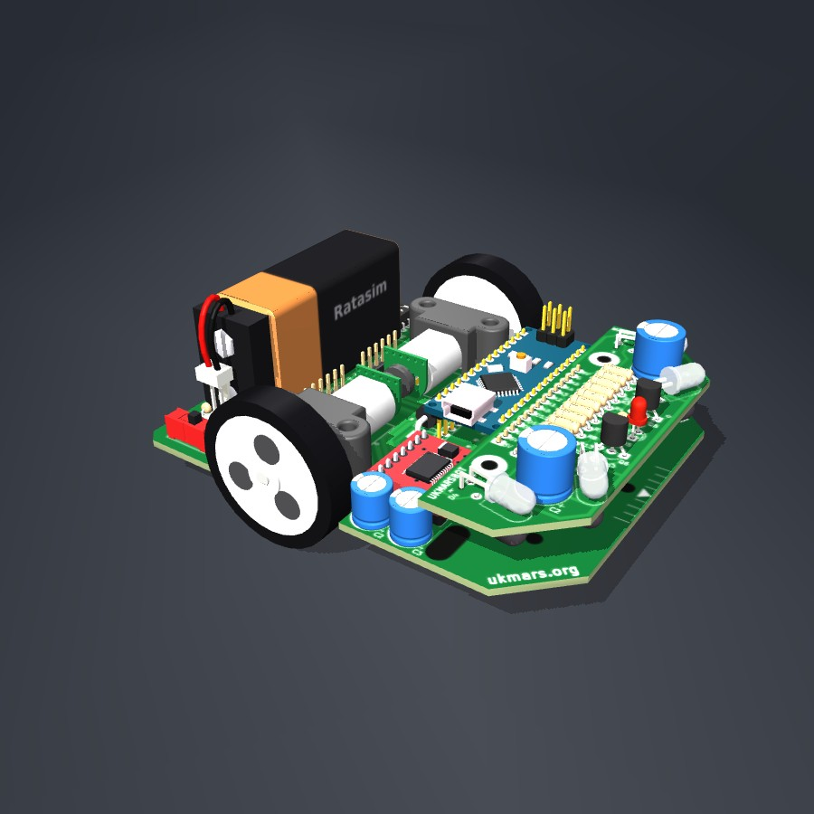

# Robots

Every robot is a package of `ratasim/` with the same parts: its **model** (meshes from its CAD, collisions from simple
shapes), its **physics** (mass, motors, tires; what was measured apart from what is assumed), its **sensors** (IR rays
through its firmware's own calibration, encoders, gyro), its **firmware**, compiled for the host from its
repository (a submodule of `external/`) on a simulated chip, and its **start**: what its makers do to start it
(buttons, a hand in front of a sensor, held in the air, commands typed over its serial link), a sequence in its config (`start()`) that
`ratasim/start.py` plays with the hand of `ratasim/hand.py`, which every sensor sees. The pictures:
`ratasim portraits`.

## Ratatron

By [JavierIH](https://github.com/JavierIH) · [JavierIH/ratatron](https://github.com/JavierIH/ratatron)

- **Firmware:** `external/ratatron/firmware/src`, unchanged, on a fake STM32 HAL (`ratasim/fw/`): its application
  files and `gpio.c`/`infrared.c` as they are, the motors, encoders, UART, flash and clock simulated.
- **Model:** its FreeCAD assembly, exported to `ratasim/assets` (`ratasim/export_cad.py`).
- **Start:** switched on in the start cell, SELECT picks mode 1, START launches the search after a 5 s countdown
  (`--race K`: race K of its race menu, on the map saved).
- **Run:** `ratasim --maze oshwdem2026` (its console stays open: `MODE 2 6`, `START`, ...). Details, calibration and
  the studies: [simulator.md](simulator.md).

## ZoroBot3

By [OPRobots](https://oprobots.org) · [OPRobots/ZoroBot3](https://github.com/OPRobots/ZoroBot3) (GPLv3)

- **Firmware:** `external/ZoroBot3`, unchanged, on a fake libopencm3 chip (`ratasim/zorobot/fw/`): its `main()` in a
  coroutine, SysTick, its control loop (TIM5) and its IR emitter/ADC state machine (TIM2, 16 kHz) every simulated
  millisecond; the LSM6DSR on SPI, the AS5145B encoders, the MP6551 motor PWM, the fan, the RGB LED, the EEPROM
  sector, the UART.
- **Model:** its Onshape assembly (the "Full Assembly", exported as one STEP file, 297 parts where its designers
  placed them), tessellated with gmsh (`ratasim/zorobot/cad.py`, `pip install -e .[cad]`). The STEP is not in its
  repository nor in this one: put it at `ratasim/zorobot/cad/Full_Assembly.step`.
- **Physics, assumed (nothing measured):** 70 g, 8520 coreless motors (R 2 Ω, 45 000 rpm at 7.4 V), 8 N of suction at
  full fan, tire friction 1.1; the wheel radius is its firmware's (12.44 mm, the CAD's tire 11.56).
- **Run:** `ratasim zorobot --maze oshwdem2026 [--run] [--record out.mp4]`: it boots, picks the run with its menu
  buttons and starts with a hand in front of its right front sensor, as on the real robot.
- **Open:** its explore turns end 3-5 deg off, so it touches walls (the assumed motors and grip).

## Gamusino

By [turmandreams](https://github.com/turmandreams) · [turmandreams/gamusino](https://github.com/turmandreams/gamusino)
(no licence file)

- **Model:** the Blender export in its repository (`external/gamusino/gamusino_3d/gamusino.glb`), read at build time
  (`ratasim/gamusino/cad.py`): its parts per body and material, its PCB's silkscreen as a texture, its fabrication
  panel's mini boards cut off the main board. Collisions: a box over the PCB, the tyres, the two ball casters.
- **Firmware:** its sketch, `external/gamusino/src/gamusino/gamusino.ino`, unchanged, for its ESP32-WROOM-32 under a
  simulated Arduino core (`ratasim/gamusino/fw/`, arduino-esp32 2.x, the one its maker builds with): turned into
  C++ as the Arduino IDE does (`gen_ino.py`: its functions' prototypes), its `setup()` and `loop()` in a coroutine,
  on a simulated clock that moves when it waits and by what its calls cost on the chip (reading the clock, a pass of
  `loop()`, each SPI byte at its bus clock, the NeoPixels' bits, an ADC conversion). Its peripherals: pins, the LEDC
  PWM channels, the ADC, SPI to its LSM6DSR (a register file: its angular rates and accelerations latched at its
  output data rate, a zero-rate offset and noise) read by the library its maker installs, STM32duino LSM6DSR
  (unchanged, downloaded at build time, pinned), ESP32Encoder's counts at the time they are read (from its wheels'
  angle and speed), the NeoPixels' colours, the serial port. What it runs: 1.5 m ahead at 1.6 m/s, steering to the
  point by its gyro and encoders, a stop, a 180 deg turn, a rest, and back, over and over; no wall sensor yet.
- **Physics, assumed:** 90 g; its motors at the speed its maker measured for each PWM duty with its wheels in the air
  (`src/pruebas/pwmtovel/resultados.txt`, its sketch's tables), pushing 0.5 N for each m/s their wheel runs below
  it; its H-bridge (its own, of MOSFETs) braking with both inputs equal; its odometry's 5.336 um a count on its
  20 mm wheels (11776 counts a turn). In the maze it reaches 1.55 m/s and stops 0.27 m after its 1.5 m.
- **Run:** `ratasim gamusino --maze oshwdem2026 [--headless] [--record out.mp4] [--max-s 30] [--echo]`: put down in the
  start cell, facing north, and switched on, as its maker starts it (green, its gyro measured after 3 s, blue: it
  goes). In the OSHWDEM 2026 maze the column along the west wall is open for 16 cells (2.88 m): its 1.5 m and its
  stop (1.77 m) fit. Coming back it stops 0.27 m past its start, so it touches the start cell's south wall once.

## Bulebule

By [Bulebots](https://github.com/Bulebots) (the Bulebule contributors) ·
[Bulebots/bulebule](https://github.com/Bulebots/bulebule) (GPLv3; its board CC BY-SA)

- **Model** (`ratasim/bulebule`, an approximation of its 2018 board: its design files went with Upverter): its board's
  outline fitted on the screenshot of its Upverter layout in Bulebots'
  [2018 talk](https://github.com/Bulebots/20180216-bulebule-making-of-presentation), its artwork recoloured from it,
  its parts where that layout's pads and the talk's photos put them; its components from [KiCad's 3D
  library](https://gitlab.com/kicad/libraries/kicad-packages3D) (downloaded at build time), through-hole ones on the
  board with their legs through it; its modules (Blue Pill, GY-6500, TB6612FNG, three DC-DC converters; the HC-05's
  socket left empty) on boards of their sizes; its IR LEDs in heat-shrink, short, none past the board's edge, lying on
  the board and bent across their pads as its build guide says: the side pairs, by the centre, look 25 deg ahead of
  sideways, the front pairs, on the shoulders, straight ahead past the board's edge; its mounts, motors, gears and
  wheels from its CadQuery scripts and its firmware's geometry (110 g, 65 mm between wheels, 22.3 mm between axles,
  21.7 mm wheels); as its photos show, tires 10.5 mm wide, flush with the board's rear tabs, rims with 9 holes and M3
  hex-head bolts. Each side's two wheels geared together.
- **Firmware:** `external/bulebule/src` and its library [mmlib](https://github.com/Bulebots/mmlib) (`src/mmlib`, its
  submodule) through its `platform.h`, unchanged but mmlib's `clock.c` (`bclock.c`: the same clock, its waits give
  the time back to the simulator), with its printf (`src/printf`), on a fake libopencm3 chip (`ratasim/bulebule/fw/`,
  the STM32F103): its `main()` in a coroutine; every simulated millisecond its emitters' timer (TIM1, 16 kHz: each
  phototransistor read dark, its emitter lit, read lit, through ADC1's injected group), USART3's DMA and SysTick (its
  clock, sensors, gyro, encoders, control, log); the MPU-6500 on SPI2 (its registers, its offset register as its
  calibration writes it), the encoders' counters (TIM2, TIM4), the motor driver's compare values (TIM3), ADC2's
  battery, the flash page that keeps its maze (kept between runs in `ratasim/bulebule/build/flash.bin`), its button
  and LEDs, its Bluetooth serial (its command line, `--console`; its log, `--echo`, `--log`).
- **Sensors:** its four IR pairs where its model puts them; the light back is its own calibration (`config.h`)
  inverted for the distance each ray of the beam would read (five rays across a gaussian beam: a wall that fills it
  reads as calibrated, a post that fills part of it farther), with noise; its gyro at 16.4 LSB per deg/s, with noise.
- **Physics, assumed (nothing measured):** 110 g, its centre of mass 4 mm ahead of its axles; Faulhaber 15 mm
  coreless motors (its docs name the maker and the IE2-512 encoders, not the motor): a 6 V one, 10 000 rpm free and
  1.5 A stall at 6 V, on its 9 V converters; its 15:60 gears; tire friction 1.0; a 1S battery at 3.9 V.
- **Run:** `ratasim bulebule --maze oshwdem2026 [--run] [--force-steps 3] [--erase-flash] [--console] [--record
  out.mp4]`: started as its makers do (`main.c`, mmlib's `hmi.c`), with its button and a hand: a press wakes it; with
  a maze saved, a short one reuses it (a run), a long one discards it; a long one picks the classic goal, short
  presses raise its force (0.1 N, +0.05 a press: 3 for its boot's 0.25 N) and a long one takes it; it blinks, waits
  with its LEDs on for a hand in front, and 2 s after the hand goes it calibrates and goes. Exploring (the OSHWDEM
  2026 maze, 0.25 N): to the centre and on through the cells that could make a shorter path, back to its start cell
  in 102 s, its path saved.
- **Open:** in its turns at speed its four wheels slide outwards (a skid-steer pulling 0.46 g on the assumed grip):
  each turn ends some 10 mm off its line. Exploring, its walls bring it back; its speed run's diagonals (`--run`)
  have no walls to follow, and it touches a post and stops (its own collision detection) on its way to the goal.
  Exploring, it touches its start cell's back wall once, reversing into its start position.

## NezumiBot

By [OPRobots](https://oprobots.org) · [OPRobots/NezumiBot](https://github.com/OPRobots/NezumiBot) (GPLv3), based on
Ratatron

- **Firmware:** `external/NezumiBot/source_code` at its OSHWDEM 2023 tag (its wall follower), unchanged but `setup.c`
  and `delay.c`, on a fake libopencm3 chip (`ratasim/nezumibot/fw/`, the STM32F401): its `main()` in a coroutine,
  its SysTick (clock, encoders, the sensors' moving average) every simulated millisecond, the TB6612's PWM (TIM2) and
  pins, the encoders (TIM3, TIM4), the sensors' ADC1 sequence that DMA copies into `sensors_raw`, USART1.
- **Sensors:** Sharp GP2Y0A51SK0F where Ratatron has them (its chassis): Ratatron's rays, hold and noise, and the
  counts for a distance from Ratatron's measured calibration; NezumiBot's own offsets (+50, +95) on top, its own.
- **Model** (`ratasim/nezumibot/assets`, from `nezumi_3d`): NezumiBot assembled. Its printed parts from its
  repository (base, lid, white cap with MARINE in blue, rims, its `Ratatron/` rear cover and motor supports), its
  electronics as its photos show them (Blackpill, TB6612FNG, N20s with encoders, Sharps, 2S LiPo, start module,
  IMU), its Ø30 tyres (measured) 70.4 mm apart, its two foam pads on the floor. Collisions: a box around its body,
  the foam pads, the tyres.
- **Physics, assumed:** 128 g and its centre of mass estimated by parts, 2S, N20 6 V (30 000 rpm free at 6 V,
  10 ohm) with 7-pulse encoders (its 78.37 um a tick on Ø30 tyres: 43:1).
- **Run:** `ratasim nezumibot --maze oshwdem2026 [--hand left|right] [--party] [--record out.mp4]`: started as its
  makers do, with a hand in front of its sensors (held in the air for its menu, then put down).

## Perenquén

By [Javier Baliñas](https://github.com/supernudo) · [supernudo/perenquen](https://github.com/supernudo/perenquen)
(CC BY-SA 4.0; its firmware GPLv2+) · its library
[supernudo/aversive4dspic](https://github.com/supernudo/aversive4dspic) (GPLv2+)

- **Firmware:** `external/perenquen/Software/perenquen-board` at its last commit (6fa4ad3, "works fine with start
  gain 30"), the files of its MPLAB X project, unchanged, with aversive4dspic (`external/aversive4dspic`) at the
  commit of the same week (786df7a, `dev-dspic33e-support`), for its dsPIC33EP512MC806 on a simulated chip
  (`ratasim/perenquen/fw/`): its part header turned into host memory at build time (`gen_sfr.py`: every register a
  word, its bit fields over it; the CPU's priority level and the ADC's control register seen as they are touched),
  its `main()` in a coroutine, Timer1 every 250 us (aversive's scheduler: its control system every millisecond), the
  ADC's manual sampling with each phototransistor lit or dark by its emitter's pin, the QEI counters, the high-speed
  PWM's duties, the clock switch. Its UART (the HC-05 Bluetooth module, 921600 baud) is simulated in place of
  aversive's dsPIC UART driver, which reaches its registers through pointers: the same API, its 128-byte FIFOs, its
  receive event (ctrl-C, "pop"). What it runs: its command line, and `start left|right <gain>`, its wall follower
  (`strat_follow_wall`).
- **Model:** its FreeCAD assembly (`Mechanics/assemblies/robot_assembly.fcstd`, A2plus), exported with
  `ratasim/perenquen/cad.py` (FreeCAD's `freecadcmd`) to `ratasim/perenquen/assets`: its main board's KiCad StepUp
  parts in their colours, its right motor block split back into its parts (Pololu micro metal gearmotor, pinion, wheel
  gears, Mini-Z wheels and tyres, magnet, supports), the left side its mirror (its designer drew one side).
  Collisions: its board (a box and a half disc up to its motor blocks), its four tyres.
- **Sensors:** where its board (`perenquen.kicad_pcb`, the board that was made; its `.net` is an older export with
  left and right swapped) puts each SFH4545 emitter and TEFT4300 phototransistor: the front pairs at the sides
  looking ahead, the diagonal pairs at the nose looking 60° out (their emitters in series, both lit by RD4). Its
  firmware has no calibration for them: the light back as the inverse square of the distance along the beam,
  assumed so that its own thresholds fall where a micromouse needs them (an obstacle, 350, at 100 mm; the end of a
  turn, 150, at 153 mm; its start, 200, at 132 mm).
- **Physics, assumed (from its design notes, `Design/design_notes.ods`):** 110 g, its centre of mass just behind its
  front axle (it turns on its front wheels), Pololu HPCB 6 V 5:1 motors (6000 rpm free, 1.6 A stall at 6 V), its
  gears as built (20:45, 11.2:1 in all), 2S, tyre friction 0.7; the wheels its firmware's 25.5 mm. Each side's two
  wheels geared together; its encoders on the rear axles, 4096 counts a turn (AS5045B).
- **Run:** `ratasim perenquen --maze oshwdem2026 [--side right|left] [--gain 30] [--speed N] [--record out.mp4]`:
  started as its maker did, from a terminal: `start <side> <gain>` typed in its start cell, then a hand in front of
  both front sensors, taken away. Its maker's notes in its code: "OK speed 1000 gain 100", "OK speed 1500 gain 200";
  with these assumed sensors it weaves at 2 m/s and gain 100, and keeps to its wall at its boot speed and gain 30.

## Fujin

By [Team Raiju](https://raiju.team/robot/fujin/v1) ([marcoabensur](https://github.com/marcoabensur),
[d-nery](https://github.com/d-nery), [sadikneipp](https://github.com/sadikneipp)) ·
[team-raiju/fujin](https://github.com/team-raiju/fujin) (no licence file: nothing of it is copied here, everything is
made from the submodule at build time)

- **Firmware:** `external/fujin/firmware` at its `RCX_2026` tag, C++23: its application (main loop, state machine,
  services, flood fill, movement profiles and control) compiled unchanged, its `main()` renamed. Its firmware is split
  into a BSP interface (`inc/bsp/*.hpp`) and its implementations; none of these is used (neither its STM32G474 one
  nor its PC one, which needs their unpublished simulator bridge). Ours, `ratasim/fujin/fw/fbsp.cpp`, implements its
  interface on the simulated board: its motors' and fan's duties, its AS5047P encoders' counts (1024 a turn) at the
  time they are read, its LSM6DSR's z rate (less the bias its firmware sets), the four IR sensors' ADC counts through
  its own conversion (`a / ln(raw + c) - b`, both ways), its wall readings at its own thresholds (230 mm at the
  sides, 205 mm ahead, its 30 mm wall confirmation and its wall breaks), its buttons' short and long presses, its
  EEPROM (erased at each boot), its LEDs and buzzer; its BLE sends nothing. `fchip.cpp` runs its loop in a coroutine
  on a simulated clock, SysTick at 2 kHz (its soft timer, its control loop's tick). What it runs: its search, from
  the start to the goal and back, its map in its EEPROM.
- **Model:** its STEP, `boards/Fujin_V1/Fujin_Body_Full.step` (its board with every component, its printed frame,
  motors, gears, Mini-Z wheels and fan), tessellated with gmsh at build time (`ratasim/fujin/cad.py`, as ZoroBot3's)
  and merged per body and colour; the axle found from its tyres. Its colours are its team's photos'
  ([raiju.team](https://raiju.team)), not its STEP's: its board sky blue, its printed frame, wheels and fan black,
  its tyres and its battery's tape black, its gears white, its emitters water-clear. Collisions: boxes over its
  board's outline, its tyres, two skids. Its tyres are drawn at its firmware's radius (13.25 mm; 12.6 in its CAD).
- **Sensors:** where its STEP puts the emitters: the front pair looking ahead, the side pair crossed, 50 deg off
  ahead. The side readings scaled to its firmware's references with the robot centred in a cell (180 mm left,
  165 mm right; its mm are not the beam's), the front ones the beam. Its firmware's side sensor angle (56.5 deg, for
  its lateral corrections, which it leaves off) is not the STEP's: with it the side sensors would read, entering a
  cell, the walls of the next one.
- **Physics, assumed (its web page: 105 g, 3S, 650 gf of suction; 1022 coreless motors, 68:9):** its motors fitted
  to its control loop's feed-forward (its own motor model, in volts); its gears' friction, its 0.13 A of Coulomb
  feed-forward; its tyres' scrub turning in place, a yaw torque against the turn (its firmware gives 0.12 A more for
  it; 0.08 A of it makes its 180.7 deg turn-around profile turn 180.5 deg: without it, 186, and its search got lost
  after its dead ends). Fan downforce 6.4 N at its rated 10 V.
- **Run:** `ratasim fujin --maze oshwdem2026 [--mode slow|medium|fast] [--headless] [--record out.mp4]`: started as
  its makers do, with its two buttons (button 2: search; button 1 held: its speeds, stepped with button 2; held: its
  exploration; held: it waits) and a hand in front of its front sensors, read for 0.4 s; two seconds' beep and it
  goes. Slow (0.3 m/s, no fan) searches the OSHWDEM 2026 maze clean: the goal in 105.7 s, back at 175 s. Medium and
  fast (its fan on) touch walls after their first turns: their curves land 10 to 15 mm off.

## Futura

By [Green Ye](https://micromouseusa.com) for UCLA IEEE's micromouse programme ·
[Project Futura](https://micromouseusa.com/?page_id=1342) (no licence given; no repository: its files are its page's
downloads)

The kit mouse of Project Futura (2014): a pre-made mouse lent to UCLA IEEE's returning members, to learn the software
on it before making their own. Its page gives its firmware template, its schematic (V1.1), its Gerber files, its
printed parts and eight lectures. Of its maker's own mice (Green Giant, 2012-2017) only the schematics and layouts
are published, no firmware: Futura is the one with code.

- **Firmware:** its kit's template, `FuturaProject.zip` (its Keil µVision project, `micromouse_test`), downloaded
  from its page at build time and checked against its SHA-256 (`ratasim/futura/config.py`); its page's certificate
  has expired, so if the download is refused for it, it is fetched unchecked and the hash vouches for it
  (`FUTURA_DOWNLOADS`: a directory with the zip, instead). Its own files, `user/` and `user_Libraries/`, unchanged,
  for its STM32F405 at 168 MHz on a simulated chip (`ratasim/futura/fw/`): ST's Standard Peripheral Library (in the
  zip, under ST's licence) is not used; `include/stm32f4xx.h` and `fchip.c` give the part of its API the template
  calls, its peripherals as host memory. Its `main()` in a coroutine on a clock of CPU cycles that moves where it
  waits: each read of its `Millis` (its delays poll it; `fsim.h` reads it through the chip), of SysTick's counter
  (its `micros()`), of a flag; SysTick's interrupt every millisecond. The ADC's single conversions with each
  phototransistor lit or dark by its emitter's pin (the template reads each one dark, lights its emitter, waits
  60 µs, reads it again), TIM2 and TIM5 counting the encoders, TIM4's four channels to its two H-bridges, TIM3's
  buzzer, its HCMS-2903 display's bytes on SPI2 (read back through its own font: the runner prints what it shows),
  its `printf` through its own `fputc` on USART1 at 9600 baud, each byte taking its time. Two words of it differ
  from Keil's C for gcc, and the build bridges them without touching its files: `matrixDisplay.h` declares the font
  `static` and `matrixDisplay.c` defines it (that file is built with the word dropped), and `fputc` and `printf`
  are renamed to the chip's (Keil's library calls `fputc`). What it runs (`user/main.c`): a 2 s beep, then over
  and over its IR pairs, gyro, battery and encoders read and printed, "mous" on its display, both motors at 100 of
  999, a second's wait. Its buttons' handlers are empty; it reads nothing from its serial port.
- **Model:** its board from its Gerber files (`Futura_Gerber.zip`, V1.1, downloaded and pinned as the firmware;
  `ratasim/futura/pcb.py`): its outline (74 x 100 mm, its nose an arc, a 9 x 32 mm notch each side for a wheel),
  its two faces textured from its layers (copper under the mask, tinned pads, silkscreen, holes), and its parts
  where its pads and holes are, at their packages' sizes: the STM32F405, the gyro, regulators, H-bridges and their
  drivers, the tantalum capacitors, a resistor or capacitor on every pair of 0603 and 0805 pads, the HCMS-2903
  display, the buzzer, the three buttons, the header, the power switch and the battery's two sockets. Its IR
  emitters and phototransistors lie on the board along the axes their holes give (square to the line of their two
  leads, as their silkscreen outlines draw them). Its two motors, end to end over the H-bridges, sit in white printed
  mounts screwed through the board's four 2.3 mm holes; its encoder boards (an AS5304/AS5306 magnetic encoder, its
  page's `encoder-V1.1.pdf`) stand at the notches' inner edges and its wheels outside them: a 69 mm track. Its
  printed wheels and skate are its page's STL files (`futura-3D-printing-model.zip`). Assumed, from the photo of its
  kit: its motors' size and height, its mounts' shape, its battery behind the motors, its board 3 mm off the floor,
  its skate under its nose (no hole marks it). Collisions: its board's outline as a convex hull up to its mounts'
  top, its skate, its tyres.
- **Sensors:** its schematic's four SFH4545 emitters and TEFT4300 phototransistors, placed by its Gerbers: LF and RF
  at the board's edges looking ahead, 7° out; DL and DR by its middle, 60° out to the sides (`config.py`); each pair
  seen from between its two lenses' tips. Its template prints the raw difference lit minus dark and has no
  threshold: the light back assumed as the inverse square of the distance along the beam, ~1900 counts at 40 mm,
  ~300 at a cell. Its LY3200ALH gyro (0.67 mV/dps) at the template's own zero (1859.6 counts), its battery through
  its divider (the template's 809/3248).
- **Physics, assumed:** 85 g, 2S 120 mAh (its kit's batteries); its motors "a 6V faulhaber" (its `pwm.c`): a
  Faulhaber 1717 006 SR, geared 12:40 as its maker's Green Giant; its encoders counted as 512 lines x4 a motor turn
  (its encoder boards read a magnetic ring by the wheel with an AS5304/AS5306, whose counts a turn depend on a ring
  its page does not name); its printed 32 mm wheels with a 1 mm tyre. At 100 of 999 it rolls at about 0.85 m/s.
- **Run:** `ratasim futura --maze oshwdem2026 [--echo] [--headless] [--record out.mp4] [--max-s 15]`: put down in the
  start cell, facing north, and switched on. In the OSHWDEM 2026 maze it rolls ten cells up the west column, from
  0.35 s to 2.3 s, and stays against the wall that ends it (a touch a second, reported), its four sensors printing
  ~4000. `--echo` prints its serial port.

## UKMARSBOT

By the [UK Micromouse and Robotics Society](https://ukmars.org/projects/ukmarsbot/) ·
[ukmars/ukmarsbot](https://github.com/ukmars/ukmarsbot) (MIT) · its firmware by
[Peter Harrison](https://github.com/micromouseonline),
[ukmars/mazerunner-core](https://github.com/ukmars/mazerunner-core) (MIT)

- **Firmware:** `external/mazerunner-core` at Peter Harrison's last commit of October 2025 (5077a4f, "adjust turn
  parameters for orion"), the robot its `config.h` selects, ORION (his UKMARSBOT: 11:1 N20 gearmotors, 18-magnet
  encoder discs, the advanced wall sensor), for the Arduino Nano (ATmega328P) on a simulated chip
  (`ratasim/ukmarsbot/fw/`): an Arduino core whose registers are objects the chip sees (`avr/io.h`), so its own
  register code runs (Timer2's 500 Hz systick, the interrupt-driven ADC reading each sensor dark and lit,
  `ATOMIC_BLOCK`, `PROGMEM`); its `setup()` and `loop()` in a coroutine, its interrupts run where the time reaches
  them, by priority, nested in systick's (`ISR_NOBLOCK`); its encoders a quadrature sequence on its pins, an
  interrupt at each edge; its serial port at 115200 baud. Its sketch is copied at build time
  (`fw/gen_src.py`) with two changes: its event set to `EVENT_UK` (its README's way: its `config.h` edited; the goal
  at (7, 7), ORION's calibration for UK contests), and one float-to-int conversion written as the AVR does it
  (`pwm_compensated()` at boot, 0 V over a battery not yet read: 0 on the AVR's 16-bit int, full reverse on x86).
  Why that commit: its tag V0.2.0 (the UK contest of 2023, OSMIUM CORE) misses its stop before a wall when its
  sensors reach their reference before its motion profile ends (it drives into the wall), the bug Peter fixed in
  October 2025 (1f1fd7a); its last commit (a revert of May 2026) applies its steering 500 times stronger than the
  gains it keeps were set for. What it runs: function 2 of its switches, its search to the goal and back,
  mapping the maze by flood fill (3: a left wall follower).
- **Model:** its two boards from their KiCad files (`ecad/kicad`: `mainboard`, `wall-sensor-advanced`, read by
  `ratasim/ukmarsbot/kicad.py`): their outlines as plates, and where their footprints are, its parts as simple solids
  of their sizes: the Arduino Nano on its sockets, the TB6612FNG module, the gearmotors in their printed brackets
  (their footprint: encoder, motor, gearbox, shaft), the IR emitters over the sensor board and the phototransistors
  under it along their axes, capacitors, resistors, switches, button; the PP3 battery standing behind the motors and
  the 32 mm wheels where its photos and renders put them, two skids. Collisions: the main board's outline up to the
  battery, its tyres (their contact 2 mm wide, at its `MOUSE_RADIUS`: a 7 mm cylinder touches the floor at its
  edges, and its turns in place came out 10° short), its skids.
- **Sensors:** where the sensor board puts each SFH4545 emitter and TEFT4300 phototransistor: the front pair at the
  sides looking 10° out, the diagonal pair at the nose looking 60° out; channels and emitters as its board's
  connector and its config. The light back from a wall: a diffuse reflector, cos(incidence) A / (d + 13.3 mm)², three
  rays across the beam; A for each from its firmware's own calibration (backed up to a wall, centred in a cell) and
  the offset from its `FRONT_REFERENCE` (850, centred before a wall): its turns' trigger then comes where its
  config says. 0.7 counts of noise (its ADC).
- **Physics, assumed:** 135 g (a PP3, two N20 with encoders, its boards, a Nano), its centre of mass just behind
  the axle; its wheels' radius from its counts a millimetre (16.4 mm); its motors as DC motors with the constants
  ORION's config measured (`FWD_KM` 475 mm/s a volt, `FWD_TM` 0.19 s, `BIAS_FF` 0.34 V), its turning inertia from
  `ROT_TM`; an 8.4 V battery.
- **Run:** `ratasim ukmarsbot --maze oshwdem2026 [--function 2|3] [--record out.mp4]`: started as at a contest:
  backed up to the start cell's wall, switched on with its button held (its maze map, kept through resets, cleared),
  its function switches at 2 and its button pressed, its LED flashing; a hand in front of its left front sensor,
  taken away: it goes. `--console` leaves its serial command line in the terminal. In the OSHWDEM 2026 maze (the
  goal 92 cells from the start) its search reaches the goal in 125 s and is back in the start cell at 186 s, its
  map right; with other seeds of its sensors' noise, 7 runs of 8 (one reaches the goal and is lost on its way
  back). Its turns' geometry is its own: its right turn starts 15 mm later than its left one (its config, tuned on
  ORION), and ends 17 mm off the centre line on a robot that follows its profile exactly, which its steering takes
  out where there are walls beside it.
