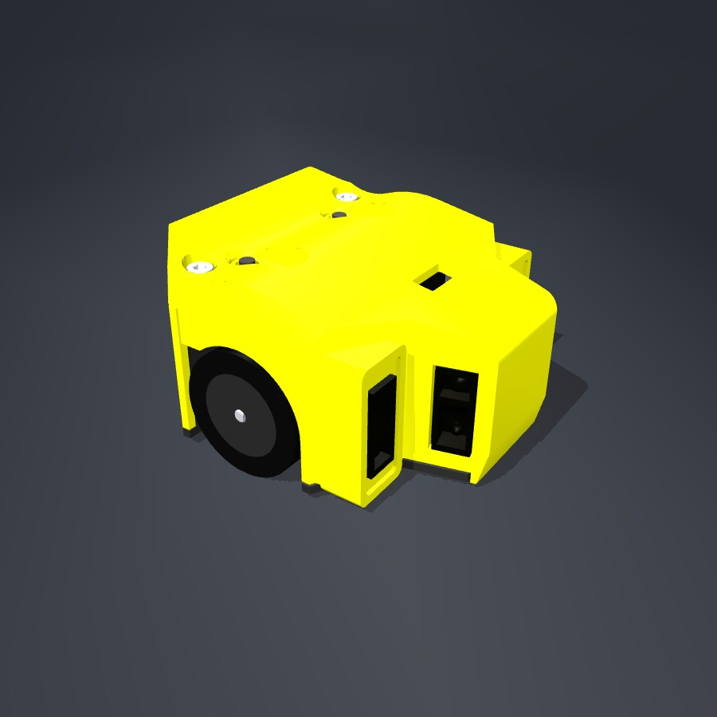
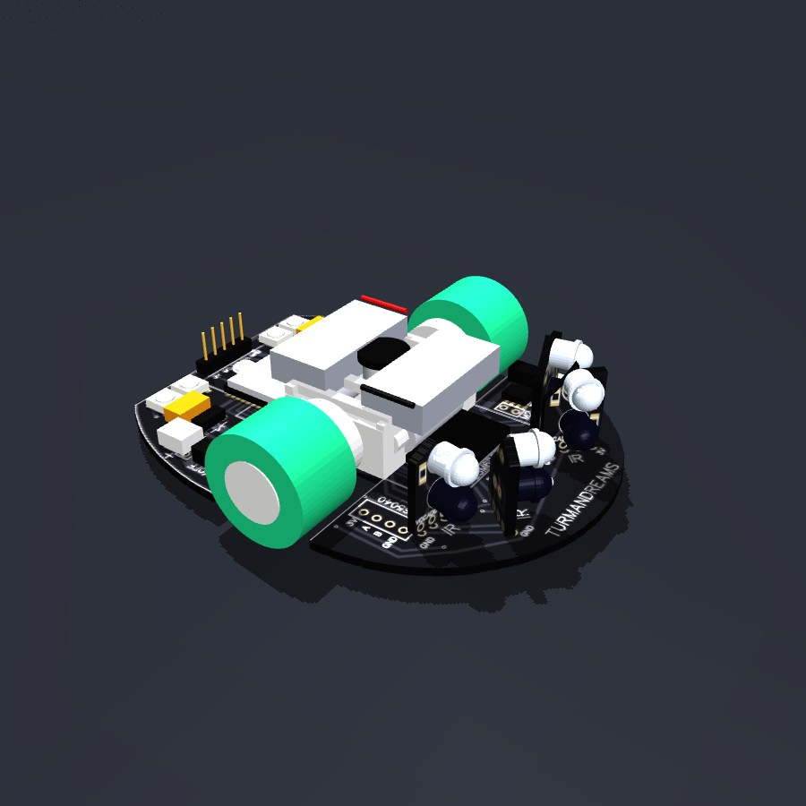
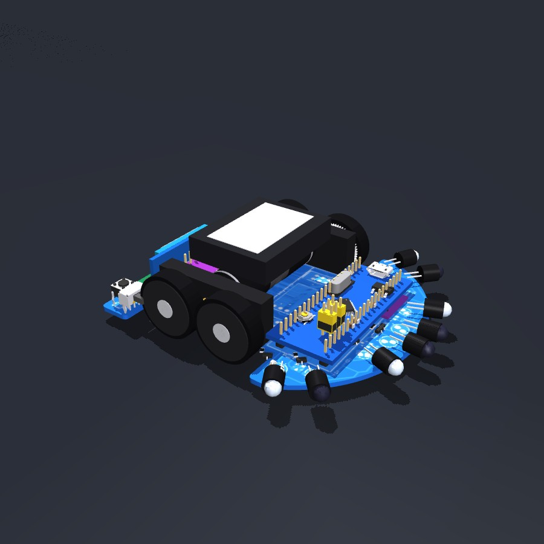

# Robots

Every robot is a package of `ratasim/` with the same parts: its **model** (meshes from its CAD, collisions from simple
shapes), its **physics** (mass, motors, tires; what was measured apart from what is assumed), its **sensors** (IR rays
through its firmware's own calibration, encoders, gyro), its **firmware**, compiled for the host from its
repository (a submodule of `external/`) on a simulated chip, and its **start**: what its makers do to start it
(buttons, a hand in front of a sensor, held in the air, commands typed over its serial link), a sequence in its config (`start()`) that
`ratasim/start.py` plays with the hand of `ratasim/hand.py`, which every sensor sees. The pictures:
`ratasim portraits`.

## Ratatron

By [JavierIH](https://github.com/JavierIH) · [JavierIH/ratatron](https://github.com/JavierIH/ratatron)

- **Firmware:** `external/ratatron/firmware/src`, unchanged, on a fake STM32 HAL (`ratasim/fw/`): its application
  files and `gpio.c`/`infrared.c` as they are, the motors, encoders, UART, flash and clock simulated.
- **Model:** its FreeCAD assembly, exported to `ratasim/assets` (`ratasim/export_cad.py`).
- **Start:** switched on in the start cell, SELECT picks mode 1, START launches the search after a 5 s countdown
  (`--race K`: race K of its race menu, on the map saved).
- **Run:** `ratasim --maze oshwdem2026` (its console stays open: `MODE 2 6`, `START`, ...). Details, calibration and
  the studies: [simulator.md](simulator.md).

## ZoroBot3

By [OPRobots](https://oprobots.org) · [OPRobots/ZoroBot3](https://github.com/OPRobots/ZoroBot3) (GPLv3)

- **Firmware:** `external/ZoroBot3`, unchanged, on a fake libopencm3 chip (`ratasim/zorobot/fw/`): its `main()` in a
  coroutine, SysTick, its control loop (TIM5) and its IR emitter/ADC state machine (TIM2, 16 kHz) every simulated
  millisecond; the LSM6DSR on SPI, the AS5145B encoders, the MP6551 motor PWM, the fan, the RGB LED, the EEPROM
  sector, the UART.
- **Model:** its Onshape assembly (the "Full Assembly", exported as one STEP file, 297 parts where its designers
  placed them), tessellated with gmsh (`ratasim/zorobot/cad.py`, `pip install -e .[cad]`). The STEP is not in its
  repository nor in this one: put it at `ratasim/zorobot/cad/Full_Assembly.step`.
- **Physics, assumed (nothing measured):** 70 g, 8520 coreless motors (R 2 Ω, 45 000 rpm at 7.4 V), 8 N of suction at
  full fan, tire friction 1.1; the wheel radius is its firmware's (12.44 mm, the CAD's tire 11.56).
- **Run:** `ratasim zorobot --maze oshwdem2026 [--run] [--record out.mp4]`: it boots, picks the run with its menu
  buttons and starts with a hand in front of its right front sensor, as on the real robot.
- **Open:** its explore turns end 3-5 deg off, so it touches walls (the assumed motors and grip).

## Gamusino

By [turmandreams](https://github.com/turmandreams) · [turmandreams/gamusino](https://github.com/turmandreams/gamusino)
(no licence file)

- **Model:** the Blender export in its repository (`external/gamusino/gamusino_3d/gamusino.glb`), read at build time
  (`ratasim/gamusino/cad.py`): its parts per body and material, its PCB's silkscreen as a texture, its fabrication
  panel's mini boards cut off the main board. Collisions: a box over the PCB, the tyres, the two ball casters.
- **Firmware:** its sketch, `external/gamusino/src/gamusino/gamusino.ino`, unchanged, for its ESP32-WROOM-32 under a
  simulated Arduino core (`ratasim/gamusino/fw/`, arduino-esp32 2.x, the one its maker builds with): turned into
  C++ as the Arduino IDE does (`gen_ino.py`: its functions' prototypes), its `setup()` and `loop()` in a coroutine,
  on a simulated clock that moves when it waits and by what its calls cost on the chip (reading the clock, a pass of
  `loop()`, each SPI byte at its bus clock, the NeoPixels' bits, an ADC conversion). Its peripherals: pins, the LEDC
  PWM channels, the ADC, SPI to its LSM6DSR (a register file: its angular rates and accelerations latched at its
  output data rate, a zero-rate offset and noise) read by the library its maker installs, STM32duino LSM6DSR
  (unchanged, downloaded at build time, pinned), ESP32Encoder's counts at the time they are read (from its wheels'
  angle and speed), the NeoPixels' colours, the serial port. What it runs: 1.5 m ahead at 1.6 m/s, steering to the
  point by its gyro and encoders, a stop, a 180 deg turn, a rest, and back, over and over; no wall sensor yet.
- **Physics, assumed:** 90 g; its motors at the speed its maker measured for each PWM duty with its wheels in the air
  (`src/pruebas/pwmtovel/resultados.txt`, its sketch's tables), pushing 0.5 N for each m/s their wheel runs below
  it; its H-bridge (its own, of MOSFETs) braking with both inputs equal; its odometry's 5.336 um a count on its
  20 mm wheels (11776 counts a turn). In the maze it reaches 1.55 m/s and stops 0.27 m after its 1.5 m.
- **Run:** `ratasim gamusino --maze oshwdem2026 [--headless] [--record out.mp4] [--max-s 30] [--echo]`: put down in the
  start cell, facing north, and switched on, as its maker starts it (green, its gyro measured after 3 s, blue: it
  goes). In the OSHWDEM 2026 maze the column along the west wall is open for 16 cells (2.88 m): its 1.5 m and its
  stop (1.77 m) fit. Coming back it stops 0.27 m past its start, so it touches the start cell's south wall once.

## Bulebule

By [Bulebots](https://github.com/Bulebots) (the Bulebule contributors) ·
[Bulebots/bulebule](https://github.com/Bulebots/bulebule) (GPLv3; its board CC BY-SA)

- **Model** (`ratasim/bulebule`, an approximation of its 2018 board: its design files went with Upverter): its board's
  outline fitted on the screenshot of its Upverter layout in Bulebots'
  [2018 talk](https://github.com/Bulebots/20180216-bulebule-making-of-presentation), its artwork recoloured from it,
  its parts where that layout's pads and the talk's photos put them; its components from [KiCad's 3D
  library](https://gitlab.com/kicad/libraries/kicad-packages3D) (downloaded at build time), through-hole ones on the
  board with their legs through it; its modules (Blue Pill, GY-6500, TB6612FNG, three DC-DC converters; the HC-05's
  socket left empty) on boards of their sizes; its IR LEDs in heat-shrink, short, none past the board's edge, lying on
  the board and bent across their pads as its build guide says: the side pairs, by the centre, look 25 deg ahead of
  sideways, the front pairs, on the shoulders, straight ahead past the board's edge; its mounts, motors, gears and
  wheels from its CadQuery scripts and its firmware's geometry (110 g, 65 mm between wheels, 22.3 mm between axles,
  21.7 mm wheels); as its photos show, tires 10.5 mm wide, flush with the board's rear tabs, rims with 9 holes and M3
  hex-head bolts. Each side's two wheels geared together.
- **Coming:** its firmware, libopencm3 on an STM32F103, its library [mmlib](https://github.com/Bulebots/mmlib) through
  its `platform.h`.

## NezumiBot

By [OPRobots](https://oprobots.org) · [OPRobots/NezumiBot](https://github.com/OPRobots/NezumiBot) (GPLv3), based on
Ratatron

- **Firmware:** `external/NezumiBot/source_code` at its OSHWDEM 2023 tag (its wall follower), unchanged but `setup.c`
  and `delay.c`, on a fake libopencm3 chip (`ratasim/nezumibot/fw/`, the STM32F401): its `main()` in a coroutine,
  its SysTick (clock, encoders, the sensors' moving average) every simulated millisecond, the TB6612's PWM (TIM2) and
  pins, the encoders (TIM3, TIM4), the sensors' ADC1 sequence that DMA copies into `sensors_raw`, USART1.
- **Sensors:** Sharp GP2Y0A51SK0F where Ratatron has them (its chassis): Ratatron's rays, hold and noise, and the
  counts for a distance from Ratatron's measured calibration; NezumiBot's own offsets (+50, +95) on top, its own.
- **Model** (`ratasim/nezumibot/assets`, from `nezumi_3d`): NezumiBot assembled. Its printed parts from its
  repository (base, lid, white cap with MARINE in blue, rims, its `Ratatron/` rear cover and motor supports), its
  electronics as its photos show them (Blackpill, TB6612FNG, N20s with encoders, Sharps, 2S LiPo, start module,
  IMU), its Ø30 tyres (measured) 70.4 mm apart, its two foam pads on the floor. Collisions: a box around its body,
  the foam pads, the tyres.
- **Physics, assumed:** 128 g and its centre of mass estimated by parts, 2S, N20 6 V (30 000 rpm free at 6 V,
  10 ohm) with 7-pulse encoders (its 78.37 um a tick on Ø30 tyres: 43:1).
- **Run:** `ratasim nezumibot --maze oshwdem2026 [--hand left|right] [--party] [--record out.mp4]`: started as its
  makers do, with a hand in front of its sensors (held in the air for its menu, then put down).

## Perenquén

By [Javier Baliñas](https://github.com/supernudo) · [supernudo/perenquen](https://github.com/supernudo/perenquen)
(CC BY-SA 4.0; its firmware GPLv2+) · its library
[supernudo/aversive4dspic](https://github.com/supernudo/aversive4dspic) (GPLv2+)

- **Firmware:** `external/perenquen/Software/perenquen-board` at its last commit (6fa4ad3, "works fine with start
  gain 30"), the files of its MPLAB X project, unchanged, with aversive4dspic (`external/aversive4dspic`) at the
  commit of the same week (786df7a, `dev-dspic33e-support`), for its dsPIC33EP512MC806 on a simulated chip
  (`ratasim/perenquen/fw/`): its part header turned into host memory at build time (`gen_sfr.py`: every register a
  word, its bit fields over it; the CPU's priority level and the ADC's control register seen as they are touched),
  its `main()` in a coroutine, Timer1 every 250 us (aversive's scheduler: its control system every millisecond), the
  ADC's manual sampling with each phototransistor lit or dark by its emitter's pin, the QEI counters, the high-speed
  PWM's duties, the clock switch. Its UART (the HC-05 Bluetooth module, 921600 baud) is simulated in place of
  aversive's dsPIC UART driver, which reaches its registers through pointers: the same API, its 128-byte FIFOs, its
  receive event (ctrl-C, "pop"). What it runs: its command line, and `start left|right <gain>`, its wall follower
  (`strat_follow_wall`).
- **Model:** its FreeCAD assembly (`Mechanics/assemblies/robot_assembly.fcstd`, A2plus), exported with
  `ratasim/perenquen/cad.py` (FreeCAD's `freecadcmd`) to `ratasim/perenquen/assets`: its main board's KiCad StepUp
  parts in their colours, its right motor block split back into its parts (Pololu micro metal gearmotor, pinion, wheel
  gears, Mini-Z wheels and tyres, magnet, supports), the left side its mirror (its designer drew one side).
  Collisions: its board (a box and a half disc up to its motor blocks), its four tyres.
- **Sensors:** where its board (`perenquen.kicad_pcb`, the board that was made; its `.net` is an older export with
  left and right swapped) puts each SFH4545 emitter and TEFT4300 phototransistor: the front pairs at the sides
  looking ahead, the diagonal pairs at the nose looking 60° out (their emitters in series, both lit by RD4). Its
  firmware has no calibration for them: the light back as the inverse square of the distance along the beam,
  assumed so that its own thresholds fall where a micromouse needs them (an obstacle, 350, at 100 mm; the end of a
  turn, 150, at 153 mm; its start, 200, at 132 mm).
- **Physics, assumed (from its design notes, `Design/design_notes.ods`):** 110 g, its centre of mass just behind its
  front axle (it turns on its front wheels), Pololu HPCB 6 V 5:1 motors (6000 rpm free, 1.6 A stall at 6 V), its
  gears as built (20:45, 11.2:1 in all), 2S, tyre friction 0.7; the wheels its firmware's 25.5 mm. Each side's two
  wheels geared together; its encoders on the rear axles, 4096 counts a turn (AS5045B).
- **Run:** `ratasim perenquen --maze oshwdem2026 [--side right|left] [--gain 30] [--speed N] [--record out.mp4]`:
  started as its maker did, from a terminal: `start <side> <gain>` typed in its start cell, then a hand in front of
  both front sensors, taken away. Its maker's notes in its code: "OK speed 1000 gain 100", "OK speed 1500 gain 200";
  with these assumed sensors it weaves at 2 m/s and gain 100, and keeps to its wall at its boot speed and gain 30.
