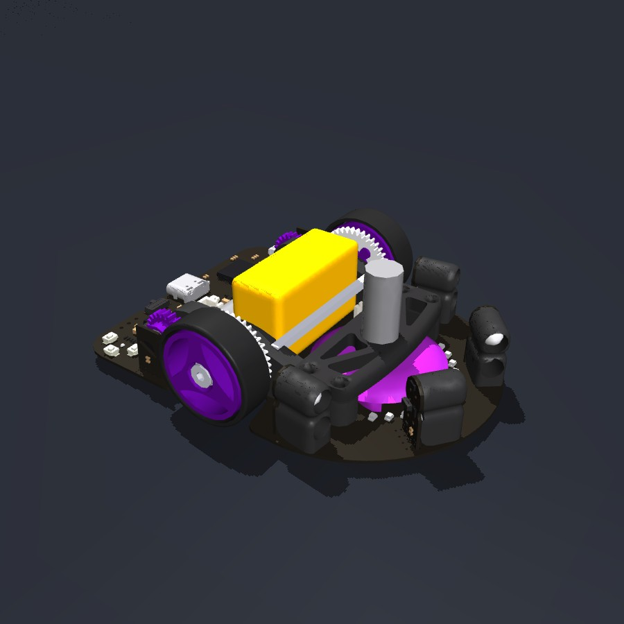
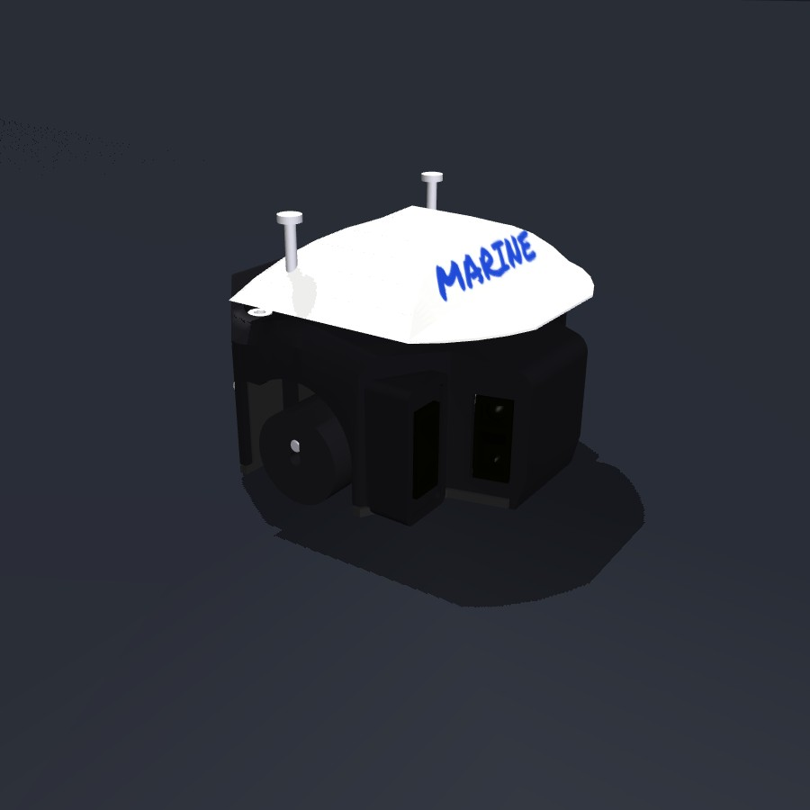

# Robots

Every robot is a package of `ratasim/` with the same parts: its **model** (meshes from its CAD, collisions from simple
shapes), its **physics** (mass, motors, tires; what was measured apart from what is assumed), its **sensors** (IR rays
through its firmware's own calibration, encoders, gyro) and its **firmware**, compiled for the host from its
repository (a submodule of `external/`) on a simulated chip. The pictures: `ratasim portraits`.

## Ratatron

By [Javier Isabel](https://github.com/JavierIH) · [JavierIH/ratatron](https://github.com/JavierIH/ratatron)

- **Firmware:** `external/ratatron/firmware/src`, unchanged, on a fake STM32 HAL (`ratasim/fw/`): its application
  files and `gpio.c`/`infrared.c` as they are, the motors, encoders, UART, flash and clock simulated.
- **Model:** its FreeCAD assembly, exported to `ratasim/assets` (`ratasim/export_cad.py`).
- **Run:** `ratasim --maze oshwdem2026`, then `MODE 1` and `START` in the console. Details, calibration and the studies:
  [simulator.md](simulator.md).

## ZoroBot3

By [OPRobots](https://oprobots.org) · [OPRobots/ZoroBot3](https://github.com/OPRobots/ZoroBot3) (GPLv3)

- **Firmware:** `external/ZoroBot3`, unchanged, on a fake libopencm3 chip (`ratasim/zorobot/fw/`): its `main()` in a
  coroutine, SysTick, its control loop (TIM5) and its IR emitter/ADC state machine (TIM2, 16 kHz) every simulated
  millisecond; the LSM6DSR on SPI, the AS5145B encoders, the MP6551 motor PWM, the fan, the RGB LED, the EEPROM
  sector, the UART.
- **Model:** its Onshape assembly (the "Full Assembly", exported as one STEP file, 297 parts where its designers
  placed them), tessellated with gmsh (`ratasim/zorobot/cad.py`, `pip install -e .[cad]`). The STEP is not in its
  repository nor in this one: put it at `ratasim/zorobot/cad/Full_Assembly.step`.
- **Physics, assumed (nothing measured):** 70 g, 8520 coreless motors (R 2 Ω, 45 000 rpm at 7.4 V), 8 N of suction at
  full fan, tire friction 1.1; the wheel radius is its firmware's (12.44 mm, the CAD's tire 11.56).
- **Run:** `ratasim zorobot --maze oshwdem2026 [--run] [--record out.mp4]`: it boots, picks the run with its menu
  buttons and starts with a hand in front of its right front sensor, as on the real robot.
- **Open:** its explore turns end 3-5 deg off, so it touches walls (the assumed motors and grip).

## Gamusino

By [turmandreams](https://github.com/turmandreams) · [turmandreams/gamusino](https://github.com/turmandreams/gamusino)
(no licence file)

- **Model:** the Blender export in its repository (`external/gamusino/gamusino_3d/gamusino.glb`), read at build time
  (`ratasim/gamusino/cad.py`): its parts per body and material, its PCB's silkscreen as a texture, its fabrication
  panel's mini boards cut off the main board. Collisions: a box over the PCB, the tyres, the two ball casters.
- **Physics, assumed:** 90 g; its maker's top speed, 1.5 m/s.
- **Coming:** its firmware, an Arduino sketch for the ESP32 (LSM6DSR gyro, encoders, NeoPixel LEDs, suction fan).

## Bulebule

By [Bulebots](https://github.com/Bulebots) (the Bulebule contributors) ·
[Bulebots/bulebule](https://github.com/Bulebots/bulebule) (GPLv3; its board CC BY-SA)

- **Coming:** its model (its board's outline and artwork from the screenshot of its Upverter layout in Bulebots'
  [2018 talk](https://github.com/Bulebots/20180216-bulebule-making-of-presentation), its components from their published
  3D models, its printed parts from its CadQuery scripts), then its firmware: libopencm3 on an STM32F103, its library
  [mmlib](https://github.com/Bulebots/mmlib) through its `platform.h`. Four wheels, Faulhaber motors with IE2-512
  encoders, an MPU-6500 gyro.

## NezumiBot

By [OPRobots](https://oprobots.org) · [OPRobots/NezumiBot](https://github.com/OPRobots/NezumiBot) (GPLv3), based on
Ratatron

- **Coming:** its model (its STLs and Ratatron's parts), its firmware: libopencm3 on an STM32F401 (BlackPill),
  Sharp GP2Y0A51SK0F sensors, N20 motors.
